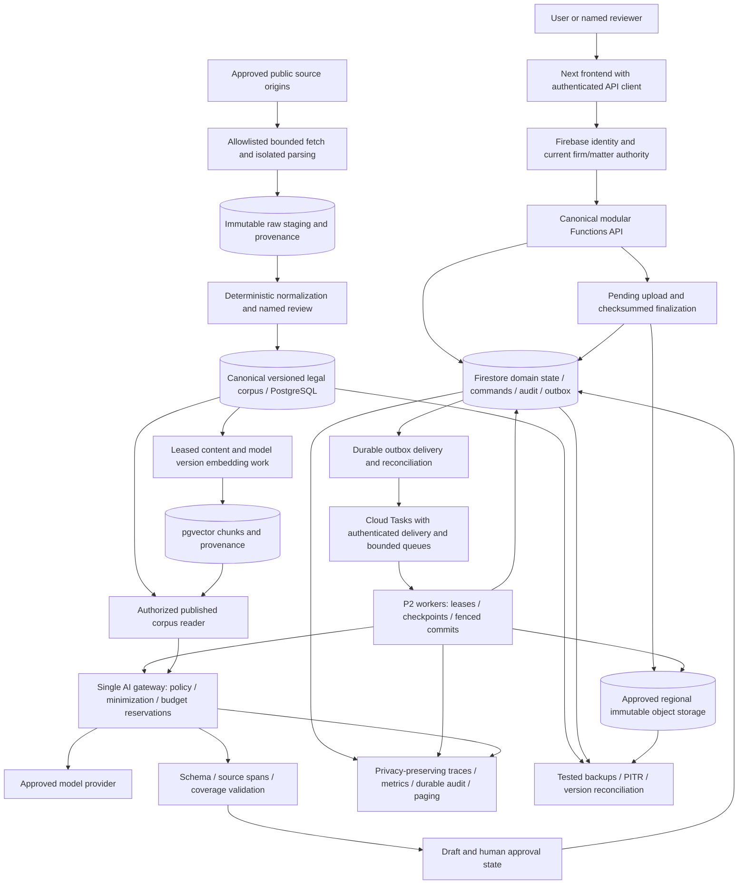

# Independent forensic audit — SIKANDER AI / Legal OS

**Verdict: NO production approval. Overall production readiness: 3.25/10 (rounded 3.3/10).**

Audited checkout: shamailsik-prog/cursor-init, commit e7e18e637eb71c16fcd2c970396af6ff8312a9fe. Audit date: 13 October 2026. The report concerns this checkout and the evidence available in the managed cloud machine. It does not certify an unseen deployment.

There are **48 material findings: 2 CRITICAL, 35 HIGH and 11 MEDIUM**. Severity concerns the failure consequence, including clearly stated deployment conditions; it is not a claim that every finding has an active remote exploit. The smallest adequate target is an authenticated frontend, one canonical modular Functions backend, Firestore with transactional operations/outboxes, Cloud Tasks workers, approved immutable object storage, and a separately reviewed PostgreSQL corpus. More services will not repair missing execution paths.

The most dangerous concrete findings are accepted uploads without retained originals; an exposed default corpus deployment manifest; job metadata readable below a matter's current classification; replay after a committed effect and error; and AI calls admitted without cost reservations. The legal authority adapter is empty in production. Corpus harvesting, review, canonical publication and retrieval do not form a demonstrated end-to-end workflow. A passing development environment must not be described as a production-ready litigation system.

## 1. Evidence standard, coverage and limits

Evidence classes used throughout:

- **Reproduced:** executable local behavior, with real functions where identified. Synthetic provider responses, caller identities and legal text were used.
- **Source verified:** an exact code/manifest path establishes the behavior or missing link. It is not automatically a production exploit reproduction.
- **Modeled:** a failure or scale scenario follows from a verified algorithm; it has not been measured under that production workload.
- **NOT DEMONSTRATED — evidence required:** a production-critical capability may exist outside the checkout, but no current artifact or operational test establishes it.
- **ARCHITECTURALLY UNVERIFIED:** a claimed capability cannot be traced into a verified execution path.
- **DOCUMENTED FEATURE — IMPLEMENTATION NOT ESTABLISHED:** specifications, placeholders or fixture paths exist without the corresponding production path.
- **ARCHITECTURAL CONTRADICTION:** concrete implementations/contracts disagree.
- **PRODUCTION BLOCKER:** the accepted production workflow cannot safely operate until the item is fixed or demonstrably removed from product scope.

All 815 tracked files were inventoried. Review prioritized active authentication, authorization, ingestion, conflict screening, AI, draft approval, jobs, corpus, data contracts, deployment and CI boundaries, with line-level inspection of the cited code and repository-wide producer/consumer/configuration searches. The inventory is not a claim that every line of every frozen governance lane, all 815 files, or the complete multi-layer architecture specification received exhaustive manual review. Uninspected peripheral behavior is not certified. The source set is unusually large for its implemented product surface; the largest code files are listed below.

| File | Measured lines |
| --- | ---: |
| app/api/d2/ops-reporting/route.ts | 33,127 |
| app/api/d4/filings/route.ts | 19,051 |
| tests/persistence.runtime-mode.test.ts | 12,006 |
| tests/persistence.route-wiring.test.ts | 9,762 |
| app/ops/operator-audit-console.tsx | 7,352 |
| platform/persistence/spineRepositories.ts | 6,733 |
| platform/spine/store.ts | 6,408 |
| platform/persistence/firestoreSpineRepositories.ts | 4,754 |

The audit did not change application source, tests, manifests, lockfiles or cloud settings; it did not deploy, publish, call paid AI, crawl third-party sources, attack a live tenant, modify real corpus records, send external messages, or merge code. Evidence/artifacts are outside the checkout. Emulator probes used isolated demo projects and were stopped after completion. The pre-existing console was left available. No live credential values were printed.

The managed machine exposes no configured secret bindings, outbound cloud identities or application runtime variable bindings through the current status tool. That does not establish that the organization has no production credentials elsewhere. Cloud network enforcement status was reported unknown at audit start; this is an observation limit, not proof of a network bypass. Local emulator evidence cannot prove real IAM, OIDC enforcement, region placement, provider availability or production firewall rules.

### Executed and reused checks

Prior onboarding checks below were executed on the same unchanged commit and their logs were retained; they were reused instead of rerunning broad suites without a new reason.

| Check | Result | What it establishes |
| --- | --- | --- |
| Root unit suite | 152 files, 3,139 tests passed | Existing unit/API fixture invariants |
| Firestore rules/persistence suite | 8 files, 614 tests passed | Emulator rules and test-injected persistence behavior |
| Functions suite with Auth/Firestore emulators | 58 files, 1,426 tests passed | Existing Functions integration paths; excludes separate G-2 suite |
| Python corpus suite | 33 tests and 8 subtests passed | Minimal pinned test environment, not full production image |
| Next build and both typechecks | Passed | Build/type compatibility of the prepared dependency tree |
| ESLint | 0 errors, 79 warnings | Static hygiene; warnings remain |
| G-0/G-1 | Passed | Static restrictions and in-memory spine tests |
| Production console local GET | Expected SIKANDER HTML | UI render, not a real authenticated workflow |

Fresh audit checks:

| Check | Result | Limit |
| --- | --- | --- |
| G-2 cross-tenant gate | PASS: 410 tested paths, 0 allowed; 10 not built, 10 out of scope, 1 global | Path counts are not distinct unit-test counts |
| G-2 Firestore rules matrix | 236 collections × 6 roles × get/list = 2,832 denied cross-firm attempts | Tested reads/roles; not proof of every possible write or future feature |
| AI burst budget probe | 10 provider calls accepted; budget 100 micro-USD, recorded spend 140,000 micro-USD | Fake provider; real local Firestore accounting |
| AI usage-commit failure | outcome OK with absent usage document | Real code with its explicit fault seam |
| Same-key post-effect 500 probe | Committed synthetic effect executed twice | Real Functions wrapper; effect handler synthetic |
| Job clearance probe | Parent matter access denied; older job returned with input/output refs | Actual getJob operation over emulator; no payload body returned |
| Legacy idempotency probe | Replay in store A, new claim in store B | Isolated per-process stores |
| Upload probe | Metadata and legacy OCR row only; no original content/object ref | Actual upload service |
| PII probe | Full-width CNIC/Urdu phone digits survived, zero redactions | Detector counterexample; no live export |
| Prompt serialization probe | System and hostile user text flattened together | Protocol behavior, not a live model jailbreak |
| Empty legal gate probe | OK, zero citations/temporal findings | Scope counterexample, not proof the sample statement is false |
| Promotion policy probe | untrusted/quarantined sources promoted; null citation throws | Real policy with a fake session, not a PostgreSQL publication |
| Public search SQL probe | Wildcard plus limit 1,000,000,000 accepted | SQL generated; no damaging load request sent |
| npm audit | 35 full-tree package findings; 20 high, 3 critical | Development/transitive/meta findings are not 35 proven exploits |
| npm audit omit-dev | 2 moderate, 0 high/critical in root | Functions/Python fresh audit scans were not rerun |

The tiny AI budget was chosen to demonstrate admission semantics, not as a realistic customer budget. No provider bill was incurred. Its overspend ratio is not a production forecast.

Unrun or unverified: a clean production Docker build; live Functions deployment/IAM; live model availability and correctness; object storage retention/download/restore; real PostgreSQL migrations/Annex A integration; chaos at cloud boundaries; live licensed vendor APIs; source crawling; browser-driven production workflows; later phase gates and mutation suites. Known passing tests do not fill these evidence gaps.

## 2. Reconstructed current architecture

**Frontend:** Next 16.4 foundation/operator consoles call Next APIs with request identities. The operator helper sends JSON and a random idempotency key, but no Firebase bearer token or firm header. It is a diagnostic/demo shell, not the proposed authenticated production shell.

**Next backend:** Domain operations mutate an in-process SpineStore and repository facade. Memory is explicitly non-durable; firestore is enabled only with a test-injected Firebase client database. Request auditing and idempotency are separate from durable effects. Large frozen governance routes coexist with a smaller active core.

**Functions backend:** A single authenticated HTTP API exposes 52 declared routes for identity/MFA, clients/conflicts/matters/entities, jobs, AI usage/policy and draft operations. Firebase users are authoritative for role/clearance/active; token claims constrain rather than expand authority. Shared policy and per-user limits exist. Many state changes have transactional audit writes. This is the best candidate for the canonical production backend.

**Job engine:** Firestore rows plus named Cloud Tasks deliveries, leases, fenced transaction steps, retries, a minute sweeper, a daily auto-confirm job and manual retry/dead-letter APIs. Current production handlers are diagnostic, entity unmerge and auto-confirm. Production subscribers are empty. Logging is not proved human alert delivery.

**AI:** Two control paths exist. Functions callP1 has model routing, masking, provider policy, output cap, usage/pricing/monthly totals and kill switches. Next/eve callCommitteeBrain uses a separate transport without these financial controls. Paid provider access was absent. Current empty DPA facts block confidential and higher classes; this is a real protective control. Public/internal export remains permitted by code. The eve bridge produces text-only results with undefined usage and buffered pseudo-streaming, not a validated full tool-call protocol.

**Legal gate:** Deterministic citation parsing/verdict and temporal checks are shared. Production uses EMPTY_AUTHORITY_STORE. Known citations become unverified and supplied temporal history is unavailable. A text with no extracted citations or temporal checks yields OK. This is a bounded verification mechanism, not substantive proof of legal correctness.

**Corpus:** Separate FastAPI/Celery/Redis/Postgres/pgvector tree, with public HTTP harvesters and manual quarantine promotion. Two compose seat workers intentionally idle because login scraping is prohibited. A Celery worker does the actual public work. Its ORM differs from the Annex A contract. No verified staged-to-reviewed-to-canonical-to-grounded-answer path exists.

**Infrastructure:** Firebase deployment files, region constants and Docker Compose are present. Complete IAM, ingress, task identity, queue placement, Terraform-equivalent state, backup policy, tested restore and alert provisioning are not demonstrated. A health response cannot establish these.

RPA/login scraping and privileged eve defaults are disabled. Keep those restrictions. Disabled capability must not be credited as functioning automation, and enabling it requires a new security and licensing review.

## 3. Feature reality and traceability matrix

Readiness labels concern the end-user production feature, not whether a helper function or test exists. For every row, the complete chain is user → API → service → job/external dependency → authoritative state → output → user confirmation. A missing step is explicit.

| Feature / claimed capability | Actual path and state | Dependencies | Failure / missing stage | Readiness and correction |
| --- | --- | --- | --- | --- |
| Foundation inspection | Page → static seeds/DDL/status | Next runtime, local data | No production tenant write promised here | Local render verified; KEEP as diagnostic |
| Staff identity/MFA | Client token → Functions router → P5 → Auth + users/claims_sync/audit | Firebase Auth, IAM, founder bootstrap, key rotation | Production UI and live deploy not verified | Backend substantially implemented; add authenticated client and cloud proof |
| Client registration | API registerClient → D1 transactional Firestore records | Auth, numbering, entity/index state | Existing UI does not reach this authenticated path | Emulator implemented; deploy/client proof required |
| Conflict screening | runConflictCheck → full registry → deterministic engine → conflict_checks/audit | Firm registry, entity links, partner resolutions | Full scans, shared version contention and no large real registry benchmark | Implemented backend; F37 required before large rollout |
| Matter opening | openMatter → refreshed screening → transaction/version fence → matters/members/parties | Cleared check, user authorization, numbering | Next legacy check-free creation differs and is frozen | Functions is canonical candidate; retire legacy writes |
| Document upload/vault | Next ingest → hash/metadata → legacy OCR jobs | Missing retained object write/read | Original bytes and completion path missing | PRODUCTION BLOCKER; F03/F04 |
| OCR | Legacy job producer; no matching P2 handler | Parser, object store, durable queue | Jobs lack P2 envelope; trigger ignores them | DOCUMENTED FEATURE — IMPLEMENTATION NOT ESTABLISHED |
| Draft version store | Functions create/save/restore → drafts/draft_versions, audit | Auth, current matter, schema/indexes | Production UI missing; closed-matter policy needs firm decision | Backend emulator paths implemented; client/deployment incomplete |
| Citation/legal currency verification | gateDraft → parser/verdict → EMPTY_AUTHORITY_STORE → result | Reviewed authority/history adapter | Real sources/treatment/history absent; empty coverage can be OK | PRODUCTION BLOCKER for automated legal verification |
| Partner draft approval | approveDraft → fresh gate/version/hash → approval lock/audit | Named partner, current result, override policy | No grounded adapter; approvals do not mean filing | Backend controlled stand-in; F05/F06 and authenticated UI |
| Committee Brain | Functions AI API → gate/mask → provider → usage + outputs | Budget/DPA/provider/model, pricing, ledger | No spend reservation; failure gaps; documents field unsupported | Conditional API implementation, production reliability not established |
| Multi-agent/tool orchestration | eve adapter → text-only P1 bridge; authored pure tools, dangerous defaults disabled | Node 24, structured tool protocol, privilege policy | No verified recursive-agent/workflow/tool result path; no model eval | ARCHITECTURALLY UNVERIFIED beyond pure authored tools; do not enable shell/browser tools |
| AI memory/RAG | In-memory/vector types and corpus DDL; no production reader | Canonical corpus, indexing, provenance and tenancy | No actual retrieval-to-answer trace | DOCUMENTED FEATURE — IMPLEMENTATION NOT ESTABLISHED |
| P2 unmerge/auto-confirm | Operation/scheduler → jobs → Tasks → fenced handlers → Firestore state | Cloud Tasks, OIDC, sweeper, IAM, indexes | Live cloud service and alerts unproved; F38 backlog risk | Strong emulator framework; conditional production readiness |
| General event automation | Events producer → onEventCreated → empty subscriber registry | Owned subscribers, event receipts | No production consumers or expired-delivery reconciliation | Framework implemented, downstream feature incomplete |
| Court filing/transport | Package/readiness and frozen governance routes → transport stub | Firm-approved portal/counter/courier transport | No actual submission, receipt/auth credential/verification path | Explicit PARTIAL; transport_stub remains true |
| WhatsApp assistant/webhook | Service/fixture paths and future gate entries | Verified webhook, signature, identity binding, delivery receipts | G-2 reports not-built paths; no live webhook integration traced | DOCUMENTED FEATURE — IMPLEMENTATION NOT ESTABLISHED as full production channel |
| Government corpus harvesting | Beat → dispatcher → public HTTP source → staging or statutes master | Source contracts, network, parsers, Postgres | Failure swallowing, review transitions absent, PDFs not durably standardized | Partial; F19/F21/F25/F26/F28 |
| Corpus human review | Shared admin key → promote → master record | Named reviewer, transaction, lineage | Idempotency/state/attribution/embed handoff missing | Unsafe publication path; F20/F23/F47 |
| Licensed PakistanLawSite API | Key selects _poll_licensed_api placeholder | Vendor endpoint/license/API contract | Configured key does not implement polling | DOCUMENTED FEATURE — IMPLEMENTATION NOT ESTABLISHED |
| Corpus import files | File manifest ingestion/staging path | Export license, actual content parser and canonical mapping | Do not credit a file import manifest as normalized searchable legal content | Require content-to-Annex A parity tests |
| Embeddings/search | Beat → pending queue → first 2,000 chars → one vector; public substring SQL | OpenAI, leases, chunk/index quality | No leases, coverage/ranking eval, versioned source mapping | Partial indexing; semantic RAG not demonstrated |
| Corpus pause/stop | API writes harvest.stopped | Actual task consumer needed | Scheduled tasks ignore it | False operational control; F29 |
| Production deploy and recovery | firebase files / Compose / constants | IAM, region, ingress, secrets, backups, restore drills | Complete reproducible cloud state absent | NOT DEMONSTRATED — PRODUCTION BLOCKER |

Feature flags correctly disable legacy governance chains and legacy check-free D1 writes by default. Do not reclassify those frozen features as production-ready merely because their tests turn flags on. A working foundation HTML page does not close any missing chain above.

## 4. Contradiction register

Each contradiction is recorded independently from the remediation findings.

| ID | Conflicting statements/implementations | Consequence | Correction |
| --- | --- | --- | --- |
| C01 | A Firestore-backed Next runtime is discussed, but runtimeRepositories accepts only a test-injected DB | Tests prove a substitute path, not production wiring | Canonical API/adapter with live configuration test; F01 |
| C02 | backend_real/frontend_real labels versus console helper without production authentication | Wired buttons are mistaken for a deployable user workflow | Redefine evidence labels around authenticated E2E completion; F02 |
| C03 | Accepted document ingest/OCR job count versus hash-only record/no P2 OCR consumer | Lost originals and permanently pending OCR | Require retained-object/readiness receipts; F03/F04 |
| C04 | Shared Firestore collection names versus different matter DTOs and ID conventions | Silent miscasting and incompatible hydration | One schema owner with migrations; F13 |
| C05 | A single governed AI gateway versus legacy provider transport outside budget/kill switches | Key placement determines whether controls apply | Remove/canonicalize legacy outbound path; F18 |
| C06 | Corpus trust vocabulary in database versus review/blocked policy branches | Real untrusted states are not blocked | One fail-closed enum; F20 |
| C07 | Annex A legal contract versus case_law_master/statutes_master | Harvest output cannot fulfill history/treatment lookup | Canonical publication ETL; F19 |
| C08 | Start/stop API acknowledgments versus no consumer of its stop file | UI states are not operational states | Durable pause/checkpoint control; F29 |
| C09 | Minimal pinned tests versus unpinned full runtime missing pgvector declaration | Green tests do not establish bootable Docker artifact | Test signed production image; F31/F46 |
| C10 | AI monthly budget as an enforced safeguard versus read-before-spend/no reservation | Multiple individually allowed requests exceed budget | Reserve atomically; F07 |
| C11 | Architecture amendments marked PROPOSED/pending signature versus code flags/rulings derived from them | Formal governing status cannot be established solely from implementation history | Obtain signed decision record and machine-readable active feature/owner catalog; preserve safe disabled defaults |
| C12 | CI Node 22 versus optional eve Node >=24 | Optional agent execution and deployable Functions use different toolchains | Split/pin targets; F48 |

C11 is a governance evidence gap, not a request to enable unsafe features. The audit does not decide legal architecture amendment authority.

## 5. Detailed findings

The following register provides the exact problem, technical explanation, failure chain, business consequence, implementable correction, priority, estimated complexity, dependencies and redesign requirement for each material finding. Source links refer to the audited checkout. P0 means before any affected production path is enabled; P1 means before broader rollout or the specified optional capability; P2 is planned simplification. A low-complexity item can still be a high-severity blocker.

### F01 — HIGH — Production Next.js persistence has no runtime adapter

**Affected component:** Next.js API and authentication. **Evidence confidence:** Source verified.

**Source evidence:** [platform/persistence/runtimeRepositories.ts:25](/workspace/cursor-init/platform/persistence/runtimeRepositories.ts:25).

**Exact problem and technical explanation:** The firestore mode requires a database supplied by setFirestorePersistenceForTests. No production Admin Firestore initialization reaches this repository layer; firebase authentication also loads identities through it. Memory is explicitly non-durable.

**Failure scenario:** Deploy with firestore selected: identity/domain calls fail closed. Enabling memory plus the production escape hatch avoids the error by accepting restart data loss.

**Business consequence:** The console can render while the application's protected workflows are unusable. This is a PRODUCTION BLOCKER, not an authentication bypass.

**Recommended correction:** Make Functions the canonical domain API and retire Next writes, or implement and integration-test a production Admin adapter. Remove the production-memory escape hatch from deployable configuration.

**Implementation:** priority P0; estimated complexity **High**; dependencies: F02, F13; architectural redesign: **Targeted redesign**.

### F02 — HIGH — The shipped consoles cannot authenticate to the production backend

**Affected component:** Foundation and operator UI. **Evidence confidence:** Source verified.

**Source evidence:** [app/ops/operator-audit-console.tsx:72](/workspace/cursor-init/app/ops/operator-audit-console.tsx:72); [app/foundation-console.tsx:119](/workspace/cursor-init/app/foundation-console.tsx:119); [.env.example:28](/workspace/cursor-init/.env.example:28).

**Exact problem and technical explanation:** The console sends body actor IDs and fresh idempotency keys, but no Firebase bearer token or X-Firm-Id. It targets Next routes, not the 52-route Functions API. The documented Flutter replacement is absent from the checkout.

**Failure scenario:** A real signed-in staff workflow cannot be traced from this UI through production authentication, conflict screening, or Functions draft approval.

**Business consequence:** frontend_real call-site coverage is not a usable authenticated production product. DOCUMENTED FEATURE — IMPLEMENTATION NOT ESTABLISHED for the replacement shell.

**Recommended correction:** Ship one authenticated shell using Firebase tokens, firm context and a typed Functions client. Keep operation IDs stable across retries; add browser tests against the real HTTP emulator endpoint.

**Implementation:** priority P0; estimated complexity **High**; dependencies: F01; architectural redesign: **Targeted redesign**.

### F03 — CRITICAL — Successful legacy uploads discard the original document bytes

**Affected component:** Document ingestion and evidence vault. **Evidence confidence:** Runtime metadata-only behavior reproduced.

**Source evidence:** [services/d1-6/uploadDocument.ts:5](/workspace/cursor-init/services/d1-6/uploadDocument.ts:5); [platform/spine/store.ts:54](/workspace/cursor-init/platform/spine/store.ts:54); [app/api/d1/documents/route.ts:226](/workspace/cursor-init/app/api/d1/documents/route.ts:226).

**Exact problem and technical explanation:** uploadDocument hashes the bytes, then stores only metadata. DocumentRecord has no object key, retained bytes or original-file location. The route persists that metadata and reports ingest success.

**Failure scenario:** A user uploads the only copy of a legal document and trusts the success response. No retrievable original exists even before a process restart; OCR has nothing durable to consume.

**Business consequence:** Irrecoverable evidence loss if this path is presented as a real document vault. The current unsupported production persistence limits exposure, but does not repair the accepted-upload contract.

**Recommended correction:** Disable success on this path until an immutable, encrypted object write is confirmed. Persist object key/version, size, MIME, digest and ownership; stage metadata plus an outbox OCR request; verify download and restoration byte-for-byte.

**Implementation:** priority P0; estimated complexity **High**; dependencies: Object storage, F01, F04; architectural redesign: **Targeted redesign**.

### F04 — HIGH — OCR jobs have no compatible worker or completion path

**Affected component:** Legacy document jobs and P2 runtime. **Evidence confidence:** Producer/consumer trace verified.

**Source evidence:** [services/d1-6/uploadDocument.ts:82](/workspace/cursor-init/services/d1-6/uploadDocument.ts:82); [functions/src/p2/functions.ts:30](/workspace/cursor-init/functions/src/p2/functions.ts:30); [functions/src/p2/registry.ts:57](/workspace/cursor-init/functions/src/p2/registry.ts:57).

**Exact problem and technical explanation:** The upload writer produces jobType=ocr without engine=p2 or the P2 payload/status envelope. onJobCreatedCore ignores non-p2 rows. The production registry contains diagnostic, unmerge and auto-confirm handlers, not OCR.

**Failure scenario:** Upload returns a positive OCR job count. No consumer claims it, no extracted text arrives, and no completion or failure reaches the user.

**Business consequence:** Zombie workflows and false ingestion progress; DOCUMENTED FEATURE — IMPLEMENTATION NOT ESTABLISHED.

**Recommended correction:** Add a versioned OCR P2 handler over durable objects with parser isolation, timeout, fenced publication, bounded retries, dead-letter escalation and user-visible status. Reject unsupported job types at creation.

**Implementation:** priority P0; estimated complexity **High**; dependencies: F03, P2 registry; architectural redesign: **Targeted redesign**.

### F05 — HIGH — Production legal authority verification uses an empty adapter

**Affected component:** Draft gate and corpus integration. **Evidence confidence:** Source verified; absence explicitly documented.

**Source evidence:** [functions/src/d4/authority.ts:31](/workspace/cursor-init/functions/src/d4/authority.ts:31); [functions/src/d4/gateOps.ts:482](/workspace/cursor-init/functions/src/d4/gateOps.ts:482).

**Exact problem and technical explanation:** activeAuthorityStore uses EMPTY_AUTHORITY_STORE outside tests. It resolves no judgment and no temporal history. Fixture-backed citation correctness cannot establish real corpus correctness.

**Failure scenario:** Every extracted citation remains unverified and every requested temporal check unavailable; partners must override without an integrated authority lookup.

**Business consequence:** Legal grounding and current-law checking are ARCHITECTURALLY UNVERIFIED. Overrides replace the missing service rather than resolving its absence.

**Recommended correction:** Implement a promoted-only corpus reader against the canonical contract. Validate citation, bench/treatment normalization, historical section versions, jurisdiction, provenance and source freshness. Test against real curated rows and unavailable-source cases.

**Implementation:** priority P0; estimated complexity **High**; dependencies: F19, curated corpus; architectural redesign: **Targeted redesign**.

### F06 — HIGH — An empty legal check is represented as OK

**Affected component:** Draft gate result semantics. **Evidence confidence:** Pure-function result reproduced.

**Source evidence:** [functions/src/d4/gate.ts:60](/workspace/cursor-init/functions/src/d4/gate.ts:60); [functions/src/d4/gateOps.ts:715](/workspace/cursor-init/functions/src/d4/gateOps.ts:715).

**Exact problem and technical explanation:** overall returns OK for zero citation findings and zero temporal checks. Temporal checks are supplied rather than inferred exhaustively. There is no coverage assertion proving all material legal claims were assessed.

**Failure scenario:** A synthetic assertion about a thirty-day statutory deadline with no citation or temporal checks produces OK. This does not prove the assertion wrong; it proves no legal verification occurred.

**Business consequence:** A narrow scanner result can be mistaken for substantive legal correctness and lead to unsafe approval.

**Recommended correction:** Return assessed scope and NOT_ASSESSED when no applicable checks ran. Require a type-specific review checklist and evidence for law-dependent documents; retain explicit human approval for uncited prose rather than banning all citation-free documents.

**Implementation:** priority P0; estimated complexity **Medium**; dependencies: F05, document-type policy; architectural redesign: **No**.

### F07 — HIGH — AI budget is a stale pre-call check, not a spending limit

**Affected component:** P1 admission and monthly accounting. **Evidence confidence:** Isolated Firestore reproduction.

**Source evidence:** [functions/src/p1/gateway.ts:147](/workspace/cursor-init/functions/src/p1/gateway.ts:147).

**Exact problem and technical explanation:** P1 reads spend before provider invocation but reserves no money for the request or concurrent requests. It checks spent>=budget rather than whether worst-case cost fits remaining budget. Accounting occurs after spend.

**Failure scenario:** Ten calls admitted against a synthetic 100 micro-USD budget all returned OK and committed 140,000 micro-USD. A single request can also exceed the remainder.

**Business consequence:** Runaway provider expenditure; rate limits per user do not bound firm-wide in-flight spend.

**Recommended correction:** Atomically reserve worst-case input/output cost per operation before dispatch. Enforce spent+reserved+newReservation<=budget, bound concurrency per firm, reconcile actual usage and release abandoned reservations through a lease reconciler.

**Implementation:** priority P0; estimated complexity **Medium**; dependencies: Durable operation IDs, F08; architectural redesign: **No**.

### F08 — HIGH — Usage-commit failure leaves accepted AI spend unaccounted

**Affected component:** P1 usage ledger and budget enforcement. **Evidence confidence:** Isolated Firestore fault injection.

**Source evidence:** [functions/src/p1/gateway.ts:286](/workspace/cursor-init/functions/src/p1/gateway.ts:286).

**Exact problem and technical explanation:** After exhausted usage-commit attempts, callP1 logs p1.usage_log_failed but returns the provider result. No durable reconciliation record is committed for the missing monthly total/usage row.

**Failure scenario:** Injected usage-write failure returned outcome=ok with no usage document. Later calls read understated spend; an instance/log retention loss can sever the reconciliation evidence.

**Business consequence:** Budget bypass during database trouble, incomplete cost reporting and missing AI decision audit/event records.

**Recommended correction:** Create a durable request/reservation before provider use, retain unresolved provider attempts, block further spend when accounting is indeterminate, and reconcile with provider receipts. Return an operation state distinguishing result availability from accounting completion.

**Implementation:** priority P0; estimated complexity **High**; dependencies: F07, durable ledger; architectural redesign: **Targeted redesign**.

### F09 — HIGH — Functions idempotency does not atomically cover committed effects

**Affected component:** Functions HTTP wrapper and post-provider writes. **Evidence confidence:** Wrapper reproduction; specific AI failure path source traced.

**Source evidence:** [functions/src/http/idempotency.ts:132](/workspace/cursor-init/functions/src/http/idempotency.ts:132); [functions/src/http/idempotency.ts:202](/workspace/cursor-init/functions/src/http/idempotency.ts:202); [functions/src/p1/ops.ts:206](/workspace/cursor-init/functions/src/p1/ops.ts:206).

**Exact problem and technical explanation:** 5xx/throw releases the claim; success settlement is a separate transaction after the handler's effect. A crash or permanent result-write failure can leave the effect committed while the key is absent or later reclaimable.

**Failure scenario:** A probe using the real wrapper and a committed synthetic Firestore effect followed by 500 executed that effect twice for the same key. In committeeBrain, provider spend precedes output persistence, so a failed output write can permit another paid call.

**Business consequence:** Duplicate external charges or actions. Not every operation duplicates: some domain operations already have independent deduplication.

**Recommended correction:** Make operation/result/outbox state atomic with database effects. For provider calls, persist a stable operation ID and attempt receipt and resume output publication without issuing a second call. Add fault tests at every effect/settlement boundary.

**Implementation:** priority P0; estimated complexity **High**; dependencies: F07, F08; domain transactions; architectural redesign: **Targeted redesign**.

### F10 — HIGH — Next.js idempotency disappears across instances and restarts

**Affected component:** Next API idempotency store. **Evidence confidence:** Two-store reproduction.

**Source evidence:** [platform/http/idempotency.ts:96](/workspace/cursor-init/platform/http/idempotency.ts:96).

**Exact problem and technical explanation:** The idempotency store is a per-process Map with eviction limits. A second instance has no knowledge of the completed key; an evicted key likewise lacks a durable completion tombstone.

**Failure scenario:** A completed request replays on instance A; the exact same key is newly claimed on instance B. A rolling restart creates the same risk.

**Business consequence:** Duplicate mutations if these routes acquire a real persistent backend; current in-process replay tests do not demonstrate distributed replay safety.

**Recommended correction:** Retire mutating Next APIs or replace the Map with durable scoped operation records and atomic effect completion. Load-test key retention and restart replay; reject capacity pressure without deleting unexpired successful operations.

**Implementation:** priority P0; estimated complexity **Medium**; dependencies: F01, F09; architectural redesign: **No**.

### F11 — HIGH — Next effects and audit publication are not atomic

**Affected component:** Next request audit and persistence. **Evidence confidence:** Source verified; crash window identified.

**Source evidence:** [platform/http/withSession.ts:260](/workspace/cursor-init/platform/http/withSession.ts:260); [platform/persistence/requestAuditFlush.ts:1](/workspace/cursor-init/platform/persistence/requestAuditFlush.ts:1).

**Exact problem and technical explanation:** The handler commits its effect before flushRequestAudit. A failed flush returns 503, with retry/dead-letter state initially tied to process lifetime. The code itself identifies the missing transactional outbox.

**Failure scenario:** Terminate an instance after effect commit but before audit flush; the action can persist without its required audit row. A retry on another instance compounds F10.

**Business consequence:** Unreconstructable legal or administrative actions and ambiguity over whether a failed request acted.

**Recommended correction:** Stage audit/outbox rows in the effect transaction. Drain with a durable reconciler and dead-letter destination, with backlog-age alerts. Do not rely on a request-finally flush to establish audit durability.

**Implementation:** priority P0; estimated complexity **Medium**; dependencies: Canonical durable transaction boundary; architectural redesign: **No**.

### F12 — HIGH — Next Firestore repositories scan all tenants before filtering

**Affected component:** Legacy Firestore repository queries. **Evidence confidence:** Source verified; G-2 does not validate production query viability.

**Source evidence:** [platform/persistence/firestoreSpineRepositories.ts:214](/workspace/cursor-init/platform/persistence/firestoreSpineRepositories.ts:214).

**Exact problem and technical explanation:** listByFirm reads the entire collection and applies firmId in JavaScript. Many list variants repeat this design. Client rules cannot turn an unrestricted query into a tenant filter; privileged adapters would still over-read.

**Failure scenario:** A rules-enforced production client rejects the query, or a privileged server pays to read every tenant for one request. Cost and latency grow with global corpus size.

**Business consequence:** Operational failure and unnecessary tenant data inside a server process; no cross-firm response leak was demonstrated.

**Recommended correction:** Query firmId and matter/visibility fields in the database, enforce indexed stable pagination, validate rows, and cap read amplification. Do not simply swap the current client SDK adapter to privileged credentials.

**Implementation:** priority P0; estimated complexity **Medium**; dependencies: F01, F13, indexes; architectural redesign: **No**.

### F13 — HIGH — The two API stacks disagree about canonical Firestore shapes

**Affected component:** Next repositories and Functions domain writes. **Evidence confidence:** Concrete row-shape mismatch traced.

**Source evidence:** [functions/src/d1/matter/ops.ts:290](/workspace/cursor-init/functions/src/d1/matter/ops.ts:290); [platform/persistence/firestoreSpineRepositories.ts:194](/workspace/cursor-init/platform/persistence/firestoreSpineRepositories.ts:194); [platform/spine/store.ts:40](/workspace/cursor-init/platform/spine/store.ts:40).

**Exact problem and technical explanation:** Functions matter documents use Firestore IDs outside the row, matterNo/stage and possibly no courtId; Next blindly casts row data to Matter requiring id, courtId, caseNumber and a narrower status union. getById does not attach the snapshot ID.

**Failure scenario:** Wire Next to the Functions database without a compatibility layer: identity/member/domain hydration receives objects missing mandatory fields or unsupported states.

**Business consequence:** Conflicting sources of truth, broken permissions or writes, and false parity claims from separate fixture shapes.

**Recommended correction:** Choose one schema owner, generate versioned validators/DTOs, attach authoritative IDs and migrate legacy data. Test both entry points against the exact same rows until Next mutations are retired.

**Implementation:** priority P0; estimated complexity **High**; dependencies: F01, F02; architectural redesign: **Targeted redesign**.

### F14 — HIGH — Job reads omit the matter's current clearance floor

**Affected component:** Functions job API. **Evidence confidence:** Actual operation reproduced in Firestore.

**Source evidence:** [functions/src/p2/ops.ts:193](/workspace/cursor-init/functions/src/p2/ops.ts:193); [functions/src/p2/view.ts:25](/workspace/cursor-init/functions/src/p2/view.ts:25).

**Exact problem and technical explanation:** getJob authorizes job.read without matterId, then checks the job's stored label and membership. It does not re-read the matter classification, which may have risen since enqueue.

**Failure scenario:** In the emulator, a confidential clerk was denied job.read on a privileged-restricted matter, yet getJob returned its old internal job including input/output document references.

**Business consequence:** Exposure of restricted matter metadata to a user below its current clearance; payload bodies were not returned by the probe.

**Recommended correction:** Apply max(jobLabel,currentMatterLabel) and current matter authorization to single, unfiltered list, retry and cancel paths. Add a regression test that raises classification after enqueue.

**Implementation:** priority P0; estimated complexity **Medium**; dependencies: Shared identity policy and current matter read; architectural redesign: **No**.

### F15 — HIGH — The PII mask is not a comprehensive confidentiality boundary

**Affected component:** Outbound prompt and trace minimization. **Evidence confidence:** Unicode counterexample reproduced.

**Source evidence:** [platform/p1/maskOutboundPII.ts:35](/workspace/cursor-init/platform/p1/maskOutboundPII.ts:35); [platform/p1/providerPolicy.ts:132](/workspace/cursor-init/platform/p1/providerPolicy.ts:132).

**Exact problem and technical explanation:** Regexes match ASCII identifiers and supplied literal party names. Full-width CNIC digits, Urdu-digit phone numbers, unsupplied names, addresses and semantic identifying facts can survive. assertMinimised reruns the same detector, not an independent assurance.

**Failure scenario:** A synthetic full-width CNIC and Urdu phone number passed with zero redactions. If such text is mislabeled internal, the provider policy allows export.

**Business consequence:** Potential privilege/PII disclosure; high classification currently remains blocked without a DPA, which reduces but does not eliminate misclassification exposure.

**Recommended correction:** Normalize Unicode for detection while preserving mapping, derive names from authoritative matter/document metadata, add independent residual-PII detection and high-risk review, and treat masking as risk reduction rather than proof of anonymity.

**Implementation:** priority P0; estimated complexity **High**; dependencies: F05, data classification, DPA decisions; architectural redesign: **No**.

### F16 — HIGH — Agent prompt serialization erases trust roles

**Affected component:** eve LanguageModel bridge and transport. **Evidence confidence:** Serialization behavior reproduced.

**Source evidence:** [platform/p1/promptText.ts:5](/workspace/cursor-init/platform/p1/promptText.ts:5); [platform/p1/committeeBrainModel.ts:54](/workspace/cursor-init/platform/p1/committeeBrainModel.ts:54); [functions/src/p1/transport.ts:92](/workspace/cursor-init/functions/src/p1/transport.ts:92).

**Exact problem and technical explanation:** The bridge concatenates system/user text; the transports send a single prompt/user message. System policy and hostile quoted text lose protocol-level separation. Non-text/tool-result parts are skipped by this serializer.

**Failure scenario:** The probe flattened a system prohibition and an untrusted 'ignore previous instructions' document into one string. No live model compromise is claimed.

**Business consequence:** Prompt injection resistance and agent context fidelity are NOT DEMONSTRATED. Current disabled privileged tools limit action impact, but do not validate answers.

**Recommended correction:** Preserve structured roles and explicitly mark untrusted document segments. Keep privileged tools disabled unless a separate deterministic policy authorizes them; add adversarial model evaluations and strict tool-input/output contracts.

**Implementation:** priority P1; estimated complexity **Medium**; dependencies: One P1 path, evaluation corpus; architectural redesign: **No**.

### F17 — HIGH — LLM outputs lack grounding and semantic evaluation evidence

**Affected component:** Committee Brain reliability. **Evidence confidence:** Implementation limit verified; model behavior not tested.

**Source evidence:** [functions/src/p1/transport.ts:110](/workspace/cursor-init/functions/src/p1/transport.ts:110); [functions/src/p1/ops.ts:206](/workspace/cursor-init/functions/src/p1/ops.ts:206); [functions/src/d4/authority.ts:31](/workspace/cursor-init/functions/src/d4/authority.ts:31).

**Exact problem and technical explanation:** The gateway accepts any string response. There is no executable legal-grounding/evidence schema on committee output and no demonstrated real-model hallucination, injection or model-version regression evaluation. Model/price strings are pinned in code, not verified live here.

**Failure scenario:** A fluent fabricated legal explanation is stored as a successful provider call; deterministic masking and 2xx transport checks do not establish truth.

**Business consequence:** Incorrect advice or draft input accepted with a misleading success status; provider availability/model identity is ARCHITECTURALLY UNVERIFIED in this environment.

**Recommended correction:** Require task-specific structured output with cited source anchors and verification status, independently resolve sources, mark ungrounded content advisory, and run a versioned Urdu/English legal evaluation set before any model/routing change.

**Implementation:** priority P0; estimated complexity **High**; dependencies: F05, F06, F16; approved model access; architectural redesign: **No**.

### F18 — HIGH — Legacy AI entry points bypass Functions budget and kill switches

**Affected component:** Next/eve P1 versus Functions P1. **Evidence confidence:** Source verified; no live credentials used.

**Source evidence:** [platform/p1/internalAICaller.ts:66](/workspace/cursor-init/platform/p1/internalAICaller.ts:66); [platform/p1/gatewayTransport.ts:27](/workspace/cursor-init/platform/p1/gatewayTransport.ts:27); [functions/src/p1/README.md:1](/workspace/cursor-init/functions/src/p1/README.md:1).

**Exact problem and technical explanation:** The legacy callCommitteeBrain/generateText path performs masking/provider policy but does not run callP1 accounting or kill switches. Presence of either supported key activates it. The README operationally forbids putting those keys on Next until migration.

**Failure scenario:** A deployment secret is mistakenly injected into the Next service or eve runtime. The legacy provider path becomes usable outside the production control plane.

**Business consequence:** Unbudgeted calls and inconsistent emergency shutdown. This is a conditional deployment hazard, not an observed live bypass.

**Recommended correction:** Remove the production-capable legacy transport or have it call the authenticated canonical P1 API. Enforce secret separation and an import/deploy gate that makes legacy paid invocation impossible.

**Implementation:** priority P0; estimated complexity **Medium**; dependencies: F02, canonical P1 endpoint; architectural redesign: **Targeted redesign**.

### F19 — HIGH — Harvest schema does not implement the application corpus contract

**Affected component:** Corpus ORM and Annex A database. **Evidence confidence:** Two concrete schemas compared.

**Source evidence:** [corpus_service/scraper/models.py:197](/workspace/cursor-init/corpus_service/scraper/models.py:197); [postgres/ddl/001_corpus_contract.sql:1](/workspace/cursor-init/postgres/ddl/001_corpus_contract.sql:1).

**Exact problem and technical explanation:** The harvester writes case_law_master/statutes_master with flat text and boolean promotion. Annex A expects judgment/citation/treatment/source_provenance and statute section/version tables. No tested ETL or adapter maps those into the production authority port.

**Failure scenario:** Harvest succeeds yet legal lookup has no compatible rows, historical versions or normalized treatments. Treating an ORM master row as Annex A would silently omit required evidence.

**Business consequence:** ARCHITECTURAL CONTRADICTION between stored corpus and claimed legal intelligence; missing source-to-answer traceability.

**Recommended correction:** Keep raw staging separate, then implement an audited, versioned publication ETL into Annex A. Reject missing provenance/history, normalize citations/treatments and validate adapter parity before connecting the application reader.

**Implementation:** priority P0; estimated complexity **High**; dependencies: F05, F20, migrations; architectural redesign: **Targeted redesign**.

### F20 — HIGH — Corpus trust-state vocabulary fails open

**Affected component:** Promotion policy and source schema. **Evidence confidence:** Policy branch reproduced; no real corpus altered.

**Source evidence:** [corpus_service/scraper/models.py:128](/workspace/cursor-init/corpus_service/scraper/models.py:128); [corpus_service/scraper/tasks/promotion.py:23](/workspace/cursor-init/corpus_service/scraper/tasks/promotion.py:23); [corpus_service/scraper/tasks/dispatcher.py:29](/workspace/cursor-init/corpus_service/scraper/tasks/dispatcher.py:29).

**Exact problem and technical explanation:** The schema permits trusted/semi_trusted/untrusted/quarantined. Dispatcher/promotion check blocked/review. Promotion auto-publishes any other source with confidence>=0.5 and defaults missing source metadata to trusted.

**Failure scenario:** Real promotion code, with a fake database transport, published semi_trusted, untrusted and quarantined sources; only the schema-incompatible review/blocked values prevented publication.

**Business consequence:** Corpus poisoning can become trusted legal authority if this dormant promotion routine is wired unchanged.

**Recommended correction:** Define one enum shared by models, migrations and policy. Only explicitly trusted, validated sources may auto-publish; unknown/missing and every lesser trust state must quarantine. Test the database constraint and all policy branches together.

**Implementation:** priority P0; estimated complexity **Medium**; dependencies: F19, F21; architectural redesign: **No**.

### F21 — HIGH — Scheduled harvesting never completes a defined normalization/publication workflow

**Affected component:** Corpus orchestration. **Evidence confidence:** Repository-wide call/reference search.

**Source evidence:** [corpus_service/scraper/tasks/celery_app.py:13](/workspace/cursor-init/corpus_service/scraper/tasks/celery_app.py:13); [corpus_service/scraper/tasks/promotion.py:7](/workspace/cursor-init/corpus_service/scraper/tasks/promotion.py:7); [corpus_service/scraper/tasks/nasirlawsite.py:46](/workspace/cursor-init/corpus_service/scraper/tasks/nasirlawsite.py:46).

**Exact problem and technical explanation:** No caller of promote_staging_records was found. Staging producers generally leave normalised false; no registered normalization task connects those rows to the promotion selector. Some statutes bypass staging by writing master directly.

**Failure scenario:** Harvester jobs repeatedly produce staging rows while search/retrieval sees no reviewed published update. Operators have no guaranteed completion boundary.

**Business consequence:** DOCUMENTED FEATURE — IMPLEMENTATION NOT ESTABLISHED for end-to-end corpus promotion, with inconsistent case/statute review gates.

**Recommended correction:** Implement explicit discovered→downloaded→parsed→normalized→quarantined/approved→published→embedded states and durable transitions. Register normalization/publication consumers and reconcile stalled rows; remove direct master writes from source tasks.

**Implementation:** priority P0; estimated complexity **High**; dependencies: F19, F20, F28; architectural redesign: **Targeted redesign**.

### F22 — MEDIUM — A citation-free staging record crashes promotion

**Affected component:** Corpus promotion routine. **Evidence confidence:** Real function reproduced with fake session.

**Source evidence:** [corpus_service/scraper/tasks/promotion.py:14](/workspace/cursor-init/corpus_service/scraper/tasks/promotion.py:14).

**Exact problem and technical explanation:** The alias sel is imported only inside the extracted_citation branch but then used unconditionally to look up source trust. Citation-free input raises UnboundLocalError.

**Failure scenario:** A normalized judgment without an extracted citation stops the routine, leaving this and later rows unpublished. The routine is currently unscheduled, so this is a latent blocker when F21 is fixed.

**Business consequence:** Missing legal content and repeated failed batches.

**Recommended correction:** Use the module-level select import, represent unknown citations as review-required, isolate a malformed record from the batch and record its durable reason. Add a real-model citation-null regression.

**Implementation:** priority P1; estimated complexity **Low**; dependencies: F21; architectural redesign: **No**.

### F23 — HIGH — Manual quarantine promotion is not an auditable state transition

**Affected component:** Corpus review API. **Evidence confidence:** Endpoint source verified.

**Source evidence:** [corpus_service/scraper/routers/quarantine.py:22](/workspace/cursor-init/corpus_service/scraper/routers/quarantine.py:22).

**Exact problem and technical explanation:** The endpoint writes a master record and reviewed=true without locking/checking prior resolution, verifying current source trust, recording reviewer/reviewedAt/reason, updating staging lineage or enqueuing embeddings. It also returns 'promoted' if the staging record is absent.

**Failure scenario:** Repeated approval can duplicate null-citation rows or hit uniqueness errors; a quarantined/invalid record can be approved with no reproducible review proof.

**Business consequence:** Unreliable provenance, inconsistent retrieval visibility and falsely acknowledged operator actions.

**Recommended correction:** Create a transaction with an expected-state/version check, stable publication identity, explicit reviewer/decision evidence, trusted-source checks and an embedding outbox. Return 404/409 for missing or previously resolved records.

**Implementation:** priority P0; estimated complexity **Medium**; dependencies: Named identity, F20, F21, F27; architectural redesign: **No**.

### F24 — HIGH — Public corpus queries have no workload bounds or publication filter

**Affected component:** Public search/case/statute APIs. **Evidence confidence:** SQL generation reproduced; no database load attack.

**Source evidence:** [corpus_service/scraper/routers/search.py:11](/workspace/cursor-init/corpus_service/scraper/routers/search.py:11); [corpus_service/scraper/routers/export.py:10](/workspace/cursor-init/corpus_service/scraper/routers/export.py:10).

**Exact problem and technical explanation:** Public list limits are unbounded integers; q may be a wildcard. Queries select full ORM rows including text and embeddings and do not enforce is_promoted or a reviewed publication view. Export loads all cases before streaming.

**Failure scenario:** A synthetic q='%' and limit=1,000,000,000 generated a broad full-row SQL query. Anonymous repeated requests can exhaust database/serialization capacity; export adds full-memory buffering.

**Business consequence:** Service denial and potential delivery of records outside the intended review boundary.

**Recommended correction:** Bound q length and limit (1–100), escape wildcard semantics, select summary DTOs, apply published-only views, indexed cursor pagination, request quotas and query timeout. Stream exports in bounded chunks on background jobs.

**Implementation:** priority P0; estimated complexity **Medium**; dependencies: Published views, rate limiter; architectural redesign: **No**.

### F25 — HIGH — Nasir source links can drive unrestricted HTTP requests

**Affected component:** Corpus fetch boundary. **Evidence confidence:** Source-level attack path verified.

**Source evidence:** [corpus_service/scraper/tasks/nasirlawsite.py:35](/workspace/cursor-init/corpus_service/scraper/tasks/nasirlawsite.py:35).

**Exact problem and technical explanation:** Every absolute http link containing case or .htm is fetched without a host/IP allowlist. Source HTML is an external input, not a trusted configuration. Other public-source connectors' host checks do not protect this path.

**Failure scenario:** An attacker controlling the source page supplies a link to an internal HTTP service or cloud metadata endpoint with a matching path/query.

**Business consequence:** SSRF and access to services reachable from the harvester; private network reachability and credential extraction were not tested.

**Recommended correction:** Route all fetches through one HTTPS allowlist client. Validate hostname, resolved public IPs, port, each redirect and final origin; block private/link-local destinations and enforce network egress restrictions.

**Implementation:** priority P0; estimated complexity **Medium**; dependencies: Central fetch policy and egress controls; architectural redesign: **No**.

### F26 — HIGH — Production PDF paths bypass the bounded downloader and parser isolation

**Affected component:** Public judgment connectors and PDF processing. **Evidence confidence:** Call paths compared; oversized file not executed.

**Source evidence:** [corpus_service/scraper/tasks/lahorehighcourt.py:155](/workspace/cursor-init/corpus_service/scraper/tasks/lahorehighcourt.py:155); [corpus_service/scraper/parsers/pdf_extractor.py:1](/workspace/cursor-init/corpus_service/scraper/parsers/pdf_extractor.py:1).

**Exact problem and technical explanation:** Judgment tasks use client.get and response.content, then synchronous PDF extraction inside the async task, rather than the bounded streaming downloader available in the same service. A PDF signature is not a resource or malware safety check.

**Failure scenario:** A malicious/oversized valid-signature PDF consumes worker memory or parser CPU before the size policy can protect it. One slow parse ties up its task slot.

**Business consequence:** Worker crashes, stalled queues and lost throughput; no parser exploit is asserted.

**Recommended correction:** Use the shared bounded download path for every connector, enforce decompressed/page/time limits, retain immutable raw files and parse in an unprivileged sandboxed subprocess with memory/CPU quotas and a malware policy.

**Implementation:** priority P0; estimated complexity **Medium**; dependencies: F03-style object retention, sandbox worker; architectural redesign: **No**.

### F27 — HIGH — Embedding work is claimed without a lease or recovery state

**Affected component:** Corpus embedding processor. **Evidence confidence:** Source verified; concurrent duplication not load-tested.

**Source evidence:** [corpus_service/scraper/tasks/embeddings.py:8](/workspace/cursor-init/corpus_service/scraper/tasks/embeddings.py:8).

**Exact problem and technical explanation:** Workers select pending rows without FOR UPDATE SKIP LOCKED or a processing lease before the external call. Missing records remain pending; retry state does not apply nextAttemptAt/backoff or durable crash ownership.

**Failure scenario:** Two tasks select the same 50 pending rows and both pay for embeddings. Recurrent missing rows occupy subsequent queue windows. A crash after provider response has no attempt receipt to reconcile.

**Business consequence:** Duplicate cost and zombie embedding work; Celery scheduling does not establish exactly-once processing.

**Recommended correction:** Claim bounded rows transactionally with leases and hash source/chunk/model into a stable operation identity. Persist provider attempt receipts, honor retry timestamps and dead-letter absent or malformed records.

**Implementation:** priority P0; estimated complexity **High**; dependencies: F19, F21, provider budget; architectural redesign: **Targeted redesign**.

### F28 — HIGH — Source failures can be acknowledged as successful Celery jobs

**Affected component:** Corpus dispatcher and source tasks. **Evidence confidence:** Exception and job-producer traces verified.

**Source evidence:** [corpus_service/scraper/tasks/dispatcher.py:9](/workspace/cursor-init/corpus_service/scraper/tasks/dispatcher.py:9); [corpus_service/scraper/tasks/pakistancode.py:46](/workspace/cursor-init/corpus_service/scraper/tasks/pakistancode.py:46); [corpus_service/scraper/tasks/embeddings.py:44](/workspace/cursor-init/corpus_service/scraper/tasks/embeddings.py:44).

**Exact problem and technical explanation:** The dispatcher retries only thrown exceptions. Several source tasks catch/log network or parse failures and return normally; embeddings catches an outer failure and returns 0. No producer of durable ScraperJob records was found for these paths.

**Failure scenario:** All fetched pages fail or the embedding database becomes unusable, yet Celery sees a successful task return. A source never updates but beat continues firing.

**Business consequence:** Silent stale corpus, zombie progress and retry policy that does not cover actual failures.

**Recommended correction:** Define typed task results and propagate retryable faults. Write source-run/checkpoint/completion records, distinguish empty-success from failure, apply bounded backoff and alert on source freshness and repeated zero-progress runs.

**Implementation:** priority P0; estimated complexity **Medium**; dependencies: F21, F34; architectural redesign: **No**.

### F29 — MEDIUM — Harvester start/stop controls do not control scheduled work

**Affected component:** Corpus dashboard and idle seat workers. **Evidence confidence:** Consumer search verified.

**Source evidence:** [corpus_service/scraper/main.py:72](/workspace/cursor-init/corpus_service/scraper/main.py:72); [corpus_service/scraper/workers/harvester.py:1](/workspace/cursor-init/corpus_service/scraper/workers/harvester.py:1); [corpus_service/scraper/tasks/dispatcher.py:17](/workspace/cursor-init/corpus_service/scraper/tasks/dispatcher.py:17).

**Exact problem and technical explanation:** The endpoints create/remove harvest.stopped. No active dispatcher or Celery task reads that file. The two seat workers only sleep, while public work runs in worker-embed/beat.

**Failure scenario:** An operator presses stop, receives stopped, and scheduled scraping/embedding continues.

**Business consequence:** False emergency control and unnecessary idle containers.

**Recommended correction:** Make pause/resume a durable control checked before enqueue and at safe checkpoints, expose in-flight work separately, and remove the two idle seat services while login scraping remains disabled.

**Implementation:** priority P1; estimated complexity **Low**; dependencies: F21, compose changes; architectural redesign: **No**.

### F30 — CRITICAL — The supplied compose stack exposes privileged stores with defaults

**Affected component:** Corpus Docker/Postgres/Redis boundary. **Evidence confidence:** Manifest verified; live exposure NOT DEMONSTRATED.

**Source evidence:** [corpus_service/docker-compose.yml:1](/workspace/cursor-init/corpus_service/docker-compose.yml:1).

**Exact problem and technical explanation:** Compose publishes PostgreSQL and unauthenticated Redis on all host interfaces; Postgres uses a shipped default password and default bootstrap superuser. API production validators may reject default credentials, but they do not remove the exposed database/broker containers.

**Failure scenario:** On a reachable deployment host without an external firewall, a network attacker can reach the database or broker. Actual deployment reachability was not available to inspect.

**Business consequence:** Corpus theft/destruction or broker task manipulation; severity is conditional on deploying this manifest on an exposed host. It is a PRODUCTION BLOCKER for that deployment model.

**Recommended correction:** Remove host store ports; isolate private networks; require unique managed secrets and TLS/Redis ACLs; use least-privilege application/database roles. Enforce a production compose/IaC policy that rejects defaults and exposed data stores.

**Implementation:** priority P0; estimated complexity **Medium**; dependencies: Deployment networking, secrets manager; architectural redesign: **No**.

### F31 — HIGH — The corpus runtime omits a directly imported dependency

**Affected component:** Corpus runtime image. **Evidence confidence:** Manifest/import mismatch verified; clean Docker execution NOT DEMONSTRATED.

**Source evidence:** [corpus_service/requirements.txt:1](/workspace/cursor-init/corpus_service/requirements.txt:1); [corpus_service/scraper/models.py:56](/workspace/cursor-init/corpus_service/scraper/models.py:56); [corpus_service/Dockerfile:1](/workspace/cursor-init/corpus_service/Dockerfile:1).

**Exact problem and technical explanation:** models imports pgvector.sqlalchemy, but requirements.txt omits pgvector while requirements-test.txt includes it. Passing the minimal test environment does not validate the dependency set used by the Docker image.

**Failure scenario:** A clean runtime image cannot be relied upon to provide pgvector unless an accidental undeclared transitive dependency supplies it; model import then fails before the API workflow starts.

**Business consequence:** Startup failure. The production Docker image was not built in this audit.

**Recommended correction:** Declare pgvector and audit the direct import-to-dependency contract. Run a clean image smoke test that imports models and starts API/Celery against PostgreSQL; separately fix runtime version pinning under F46.

**Implementation:** priority P0; estimated complexity **Medium**; dependencies: Build pipeline and pinned artifacts; architectural redesign: **No**.

### F32 — HIGH — The production deployment contract is not reproducibly enforced

**Affected component:** Cloud runtime, IAM and release controls. **Evidence confidence:** Code requirements verified; external state unavailable.

**Source evidence:** [functions/src/deployConfig.ts:1](/workspace/cursor-init/functions/src/deployConfig.ts:1); [firebase.json:1](/workspace/cursor-init/firebase.json:1); [functions/src/p2/functions.ts:52](/workspace/cursor-init/functions/src/p2/functions.ts:52).

**Exact problem and technical explanation:** Code assumes asia-south1 database placement, Cloud Tasks OIDC/IAM and scheduler permissions. Default API ingress is ALLOW_ALL; trusting proxy hops only warns when direct ingress remains open. No versioned infrastructure manifest establishes the required IAM/network/max-instance/TTL/alert settings.

**Failure scenario:** A deploy renders a health response while triggers, queues, TTL cleanup or trusted-IP semantics are broken; an incorrect region can prevent triggers from deploying.

**Business consequence:** Outage, uncontrolled cost or spoofable IP-based limits under the documented unsafe proxy combination. Live cloud control-plane evidence is NOT DEMONSTRATED.

**Recommended correction:** Provision database location, IAM, task/scheduler identities, constrained ingress, quotas, TTL/index policies and release settings as code. Fail incompatible proxy/ingress combinations and test a clean staging deployment before promotion.

**Implementation:** priority P0; estimated complexity **High**; dependencies: Cloud administrator/IaC evidence; architectural redesign: **Targeted redesign**.

### F33 — HIGH — Backup and restoration capability is unproven

**Affected component:** All durable data and raw files. **Evidence confidence:** NOT DEMONSTRATED — external evidence required.

**Source evidence:** [corpus_service/docker-compose.yml:78](/workspace/cursor-init/corpus_service/docker-compose.yml:78); [postgres/ddl/001_corpus_contract.sql:1](/workspace/cursor-init/postgres/ddl/001_corpus_contract.sql:1); [firebase.json:1](/workspace/cursor-init/firebase.json:1).

**Exact problem and technical explanation:** No reviewed backup/restore implementation, restore drill, RPO/RTO evidence or recovery ownership was supplied for Firestore, Postgres and document objects. A mounted volume is not a backup.

**Failure scenario:** Volume/project loss or accidental deletion cannot be recovered from a tested recovery artifact.

**Business consequence:** Catastrophic recovery gap; this is an evidence blocker, not proof the external organization has no backups.

**Recommended correction:** Implement encrypted point-in-time backups and immutable object versions. Restore into a clean isolated environment and verify content digests, record counts and relationships. Publish measured RPO/RTO and drill ownership.

**Implementation:** priority P0; estimated complexity **High**; dependencies: F03, F19, cloud data owners; architectural redesign: **No**.

### F34 — HIGH — AI and workflow traces cannot establish decision reproducibility

**Affected component:** AI tracing and workflow observability. **Evidence confidence:** Endpoint/log behavior verified; deployed alerts NOT DEMONSTRATED.

**Source evidence:** [functions/src/p1/opik.ts:92](/workspace/cursor-init/functions/src/p1/opik.ts:92); [functions/src/p1/gateway.ts:266](/workspace/cursor-init/functions/src/p1/gateway.ts:266); [platform/p1/committeeBrainModel.ts:27](/workspace/cursor-init/platform/p1/committeeBrainModel.ts:27).

**Exact problem and technical explanation:** P1 usage metadata records model/task/classification but not a prompt-template version, provider/model revision or retrieved source/version set. Opik export may be disabled or lost fail-open. The eve bridge reports undefined usage. No joined per-stage decision trace is demonstrated.

**Failure scenario:** An operator investigates a wrong answer or model behavior change and cannot reconstruct the exact prompt policy, authoritative source versions and execution stages from durable records.

**Business consequence:** Incident reconstruction and model regression attribution are NOT DEMONSTRATED; having a trace ID is insufficient.

**Recommended correction:** Persist redacted operation/attempt metadata including prompt hash/template version, model/provider revision, retrieval anchors, tool decisions, phase timings, cost and user approval. Keep restricted text out of third-party traces, and reconcile missing trace exports.

**Implementation:** priority P0; estimated complexity **Medium**; dependencies: F08, F28, F32; architectural redesign: **No**.

### F35 — MEDIUM — Timed-out job handlers are not cancelled

**Affected component:** P2 worker execution contract. **Evidence confidence:** Source-documented limitation.

**Source evidence:** [functions/src/p2/worker.ts:1](/workspace/cursor-init/functions/src/p2/worker.ts:1); [functions/src/p2/registry.ts:16](/workspace/cursor-init/functions/src/p2/registry.ts:16).

**Exact problem and technical explanation:** Handler execution is raced against a budget but JobContext has no AbortSignal. The old handler continues until settlement/function termination. Firestore fenced steps limit database commits, but cannot cancel or fence an already issued external effect.

**Failure scenario:** A future provider/transport handler times out, the failure commit schedules a retry, and the old external request also completes.

**Business consequence:** Duplicate or late side effects and resource waste; current production handlers are principally internal database work, so paid external impact is prospective.

**Recommended correction:** Add deadline/AbortSignal propagation and reject side effects after lease loss. Use provider-side operation IDs and durable intent/receipt records for every external action; add a slow handler that ignores cancellation to the chaos suite.

**Implementation:** priority P1; estimated complexity **Medium**; dependencies: F09, handler cooperation; architectural redesign: **No**.

### F36 — MEDIUM — Event fan-out is a framework without production subscribers or reconciliation

**Affected component:** P2 event subscriptions. **Evidence confidence:** Empty registry and retry contract verified.

**Source evidence:** [functions/src/p2/fanout.ts:25](/workspace/cursor-init/functions/src/p2/fanout.ts:25); [functions/src/p2/functions.ts:63](/workspace/cursor-init/functions/src/p2/functions.ts:63).

**Exact problem and technical explanation:** SUBSCRIBERS is empty. Retry:true supplies bounded platform redelivery, not a durable event-to-consumer completion ledger. Beyond the retry horizon there is no scan repairing missing subscriber jobs.

**Failure scenario:** Documented event-driven downstream features emit events but have no registered consumer, or a later subscription loses events during a prolonged outage.

**Business consequence:** ARCHITECTURALLY UNVERIFIED downstream automation; not a defect in an intentionally unused event framework itself.

**Recommended correction:** For each enabled event, register an owned consumer and a durable event/subscriber delivery record. Reconcile missing jobs, version payloads and test duplicate/out-of-order/redelivery after retention expiry.

**Implementation:** priority P1; estimated complexity **Medium**; dependencies: Real feature consumers, F34; architectural redesign: **No**.

### F37 — HIGH — Conflict checks materialize the entire firm registry

**Affected component:** Functions conflict engine and matter opening. **Evidence confidence:** Algorithm verified; numerical example is a model, not a benchmark.

**Source evidence:** [functions/src/d1/conflict/engine.ts:113](/workspace/cursor-init/functions/src/d1/conflict/engine.ts:113); [functions/src/d1/matter/ops.ts:245](/workspace/cursor-init/functions/src/d1/matter/ops.ts:245).

**Exact problem and technical explanation:** Each check loads all firm clients, matters, opposing parties, entity links and transliteration mappings into memory. Matter opening may re-screen when a shared registry version changes. There is no incremental candidate index on this path.

**Failure scenario:** With 100,000 firm rows and 10 screenings/s, reading even one full-row collection costs roughly 1,000,000 document reads/s before the others; concurrent registry mutations force repeated scans.

**Business consequence:** Conflict screening timeouts, high read bills and reduced ability to open matters safely.

**Recommended correction:** Use normalized deterministic-key candidate queries and a versioned indexed search projection. Validate only relevant candidate/version sets transactionally; retain fail-closed screening and batch rare full reconciliations asynchronously.

**Implementation:** priority P1; estimated complexity **High**; dependencies: Schema indexes, sound candidate recall proof; architectural redesign: **Targeted redesign**.

### F38 — HIGH — Auto-confirm's fixed oldest-row window can starve later eligible pairs

**Affected component:** Daily entity reconciliation. **Evidence confidence:** Bounded query verified; starvation scenario not load-reproduced.

**Source evidence:** [functions/src/d1/entity/autoConfirmJob.ts:195](/workspace/cursor-init/functions/src/d1/entity/autoConfirmJob.ts:195).

**Exact problem and technical explanation:** The scan takes the first 2,000 old candidate rows and at most 480 pair steps/day. Ineligible pairs remain candidates at the head; no continuation cursor or durable eligibility index advances past them.

**Failure scenario:** At least 2,000 persistent old candidates that fail readPair/effective-state eligibility can repeatedly occupy the window, so eligible rows behind them never materialize.

**Business consequence:** Zombie candidate links and incomplete conflict normalization; daily success does not imply backlog completion.

**Recommended correction:** Persist eligibility/dueAt and scan eligible pairs with a stable cursor/high-watermark, record deferred reasons and checkpoint continuation jobs. Test more than 2,000 ineligible head rows followed by eligible rows and alert on oldest eligible age.

**Implementation:** priority P1; estimated complexity **Medium**; dependencies: F37, indexed pair state; architectural redesign: **No**.

### F39 — HIGH — The root frozen dependency installation fails

**Affected component:** Dependency and toolchain reproducibility. **Evidence confidence:** npm ci failure reproduced during onboarding.

**Source evidence:** [package.json:1](/workspace/cursor-init/package.json:1); [package-lock.json:1](/workspace/cursor-init/package-lock.json:1); [.github/workflows/gate-g0.yml:26](/workspace/cursor-init/.github/workflows/gate-g0.yml:26); [functions/package.json:1](/workspace/cursor-init/functions/package.json:1).

**Exact problem and technical explanation:** Root npm ci fails because the package.json eve undici@8.11.2 override is absent from package-lock.json. Setup used npm install --package-lock=false to preserve repository files, so installed dependencies are not a verified frozen reproduction.

**Failure scenario:** A clean CI runner stops before tests; rebuilding from the checked-in manifests does not reproduce the prepared root environment.

**Business consequence:** Blocked CI and unverifiable release reproducibility. A working cloud snapshot does not fix this contract.

**Recommended correction:** Repair the lockfile in a separate reviewed code change, pin the package manager, and require a clean npm ci plus artifact provenance comparison for every release.

**Implementation:** priority P0; estimated complexity **Low**; dependencies: Dependency change review; architectural redesign: **No**.

### F40 — MEDIUM — Development supply-chain risk is excluded from the current advisory gate

**Affected component:** CI/build/deploy tooling. **Evidence confidence:** Registry scan verified; exploitability not demonstrated.

**Source evidence:** [docs/audits/known-advisories.md:16](/workspace/cursor-init/docs/audits/known-advisories.md:16); [.github/workflows/security.yml:1](/workspace/cursor-init/.github/workflows/security.yml:1).

**Exact problem and technical explanation:** The policy excludes dev dependencies, although build, emulator, test and deployment tooling run with repository or release privileges. Fresh npm audit reported 35 package findings (20 high, 3 critical); root omit-dev reported only two moderate. Scanner counts include transitive/meta findings and are not 35 proven exploitable defects.

**Failure scenario:** A malicious archive, test fixture or tooling input reaches a vulnerable development package in a privileged CI job. Runtime exposure is not demonstrated; blindly accepting proposed downgrades is unsafe.

**Business consequence:** Build/release compromise risk and inconsistent supply-chain assurance.

**Recommended correction:** Triage direct advisory IDs and reachable tooling usage separately; upgrade supported tooling with a clean lockfile, use short-lived job-scoped credentials, isolate artifact extraction and preserve signed artifact provenance. Do not blindly run audit fix --force.

**Implementation:** priority P1; estimated complexity **Medium**; dependencies: F39, least-privilege CI; architectural redesign: **No**.

### F41 — MEDIUM — Legacy governance expansion overwhelms active product boundaries

**Affected component:** Frozen routes, repositories and operator console. **Evidence confidence:** File counts measured; frozen defaults verified.

**Source evidence:** [app/api/d2/ops-reporting/route.ts:1](/workspace/cursor-init/app/api/d2/ops-reporting/route.ts:1); [app/api/d4/filings/route.ts:1](/workspace/cursor-init/app/api/d4/filings/route.ts:1); [platform/flags/featureFlags.ts:26](/workspace/cursor-init/platform/flags/featureFlags.ts:26).

**Exact problem and technical explanation:** A 33,127-line ops route, 19,051-line filings route, 7,352-line console and duplicated governance adapters implement hundreds of largely frozen lineage chains. Named re-exports and mirror tests create change surfaces disproportionate to the active product. Frozen code still consumes build/review effort.

**Failure scenario:** A shared bug is copied across many near-identical adapters; a tiny lifecycle change requires broad repetitive edits and can miss one lineage. Wiring tests can pass without proving usable business behavior.

**Business consequence:** Expensive maintenance, review blind spots and architectural effort diverted from missing production basics.

**Recommended correction:** Keep frozen behavior disabled. Extract one versioned typed lifecycle engine and explicit transition catalog behind existing APIs, prove parity, and archive/delete obsolete chains only after the required owner decision. Do not replace domain-specific legal rules with a generic engine.

**Implementation:** priority P2; estimated complexity **High**; dependencies: Owner authorization for deletion, contract tests; architectural redesign: **Targeted redesign**.

### F42 — HIGH — Confidential data retention and deletion cannot be traced across copies

**Affected component:** Matter data, objects, prompts, vectors and logs. **Evidence confidence:** NOT DEMONSTRATED — policy and execution evidence required.

**Source evidence:** [functions/src/p1/ops.ts:225](/workspace/cursor-init/functions/src/p1/ops.ts:225); [functions/src/p1/opik.ts:108](/workspace/cursor-init/functions/src/p1/opik.ts:108); [corpus_service/scraper/models.py:274](/workspace/cursor-init/corpus_service/scraper/models.py:274).

**Exact problem and technical explanation:** The repository stores document metadata, masked prompt/output records and optional trace content, but no end-to-end retention/deletion protocol was demonstrated across all representations. Operational TTL fields for counters/keys do not establish legal-content retention.

**Failure scenario:** A matter is deleted or its access revoked while searchable/vector/trace/output copies remain retrievable or retained without a documented legal hold.

**Business consequence:** Confidential-data handling obligations and deletion completeness remain NOT DEMONSTRATED.

**Recommended correction:** Create an explicit data inventory and legal-hold/retention policy; execute authorized deletions through durable tombstones and per-store acknowledgments. Test deletion in objects, records, vectors, trace stores and backups subject to approved retention.

**Implementation:** priority P0; estimated complexity **High**; dependencies: Firm retention decisions, F03, F19; architectural redesign: **Targeted redesign**.

### F43 — HIGH — Logs are used as alert delivery without proved escalation

**Affected component:** P2 dead letters, queue dispatch and AI budgets. **Evidence confidence:** Log mechanisms verified; actual alert policy NOT DEMONSTRATED.

**Source evidence:** [functions/src/p2/jobEvents.ts:22](/workspace/cursor-init/functions/src/p2/jobEvents.ts:22); [functions/src/p2/functions.ts:30](/workspace/cursor-init/functions/src/p2/functions.ts:30); [functions/src/p1/gateway.ts:294](/workspace/cursor-init/functions/src/p1/gateway.ts:294).

**Exact problem and technical explanation:** Dead-letter/budget notifications are log lines. No deployed alert rule, tested delivery or acknowledgment/escalation chain was supplied. Repeated queue dispatch failures keep jobs queued, so they may never generate the dead-letter alert.

**Failure scenario:** Cloud Tasks dispatch stays broken; sweeps log/retry while the user sees queued. Nobody is demonstrably notified, and a saga can remain unmerging indefinitely.

**Business consequence:** Missed deadlines and zombie workflows; existing monitoring configuration outside this checkout is unknown.

**Recommended correction:** Provision alerts for dispatch/commit failures, oldest queue/saga age, dead letters, unresolved spend and source freshness. Deliver to a named operator and partner worklist with acknowledgment and escalation; exercise every route through fault injection.

**Implementation:** priority P0; estimated complexity **Medium**; dependencies: F32, operational ownership; architectural redesign: **No**.

### F44 — MEDIUM — Health endpoints can stay HTTP-green during dependency failure

**Affected component:** Functions and corpus readiness. **Evidence confidence:** Endpoint source verified.

**Source evidence:** [functions/src/health.ts:15](/workspace/cursor-init/functions/src/health.ts:15); [corpus_service/scraper/main.py:38](/workspace/cursor-init/corpus_service/scraper/main.py:38).

**Exact problem and technical explanation:** Functions health always returns status ok. Corpus DB failure returns a degraded JSON body with HTTP 200, and each probe traverses PDF files/seen state. Neither establishes queue, provider-accounting or object-store readiness.

**Failure scenario:** A status-only load balancer routes traffic to a service whose database is unavailable; frequent probes scan a growing file vault and add work during an incident.

**Business consequence:** Delayed outage detection and avoidable probe overhead.

**Recommended correction:** Provide cheap liveness and separate bounded readiness returning 503 for required dependency failures. Expose cached freshness/queue telemetry rather than recursive file enumeration, and test health under database and dispatch failure.

**Implementation:** priority P1; estimated complexity **Low**; dependencies: Dependency-specific SLO/readiness decisions; architectural redesign: **No**.

### F45 — MEDIUM — The embedding representation omits most document content

**Affected component:** Corpus retrieval representation. **Evidence confidence:** Representation verified; real retrieval performance NOT DEMONSTRATED.

**Source evidence:** [corpus_service/scraper/tasks/embeddings.py:26](/workspace/cursor-init/corpus_service/scraper/tasks/embeddings.py:26).

**Exact problem and technical explanation:** Embedding input takes only the first 2,000 characters of full_text/section_text and mixes title/citation into one vector. No versioned chunk/page coverage, retrieval ranking evaluation or later-page evidence mapping is implemented on this path.

**Failure scenario:** The controlling paragraph appears late in a long judgment and cannot contribute to its embedding. A completed queue item incorrectly suggests the document was fully represented for semantic retrieval.

**Business consequence:** Low recall and misleading retrieval/grounding claims. The public search itself is substring matching, not RAG.

**Recommended correction:** Build versioned, language-aware chunks with page/paragraph anchors and content hashes; evaluate hybrid lexical/vector retrieval on real legal queries, including later-page holdings and Urdu content, before promising document-wide semantic search.

**Implementation:** priority P1; estimated complexity **Medium**; dependencies: F19, F27, curated evaluations; architectural redesign: **Targeted redesign**.

### F46 — MEDIUM — Corpus runtime artifacts are mutable and diverge from the pinned test environment

**Affected component:** Corpus production build. **Evidence confidence:** Manifest comparison verified.

**Source evidence:** [corpus_service/requirements.txt:1](/workspace/cursor-init/corpus_service/requirements.txt:1); [corpus_service/requirements-test.txt:1](/workspace/cursor-init/corpus_service/requirements-test.txt:1); [corpus_service/Dockerfile:1](/workspace/cursor-init/corpus_service/Dockerfile:1); [corpus_service/docker-compose.yml:1](/workspace/cursor-init/corpus_service/docker-compose.yml:1).

**Exact problem and technical explanation:** The production requirements have no versions/hashes and images use mutable tags; the 33-test environment pins a different minimal dependency set. A test pass cannot certify future runtime resolution, native parsers or browser packages.

**Failure scenario:** Rebuild weeks later changes SQLAlchemy/parser/browser behavior or introduces an advisory without a source change; binary extraction behavior becomes irreproducible.

**Business consequence:** Supply-chain and forensic reproducibility weakness.

**Recommended correction:** Lock production Python dependencies with hashes and image digests, retain an SBOM and parser versions, and test the actual signed image rather than substituting the minimal test environment. Refresh artifacts through controlled upgrades.

**Implementation:** priority P1; estimated complexity **Medium**; dependencies: F31, CI artifact store; architectural redesign: **No**.

### F47 — MEDIUM — Corpus administration uses one all-powerful shared key

**Affected component:** Corpus administrative APIs. **Evidence confidence:** Authentication mechanism verified; no live key exposed.

**Source evidence:** [corpus_service/scraper/auth.py:14](/workspace/cursor-init/corpus_service/scraper/auth.py:14); [corpus_service/scraper/routers/sources.py:33](/workspace/cursor-init/corpus_service/scraper/routers/sources.py:33); [corpus_service/scraper/routers/quarantine.py:22](/workspace/cursor-init/corpus_service/scraper/routers/quarantine.py:22).

**Exact problem and technical explanation:** require_admin_api_key authenticates possession of one static key, without named operator identity, distinct scopes, expiry or a demonstrated rotation overlap mechanism. Trigger/export/promotion use the same authority.

**Failure scenario:** A copied dashboard/admin key permits source triggering, bulk exports and promotion. Revoking one operator requires rotating the shared key for everyone, and reviewer attribution cannot be derived from it.

**Business consequence:** Weak attribution and broad credential blast radius; constant-time comparison correctly limits timing leakage but not privilege.

**Recommended correction:** Use named short-lived OIDC identities and scoped corpus roles for trigger/review/export; require step-up for publication. Log immutable actor/decision context and test revocation plus key/token rotation without downtime.

**Implementation:** priority P1; estimated complexity **Medium**; dependencies: Identity provider, F23; architectural redesign: **No**.

### F48 — MEDIUM — Optional eve execution needs a different Node target from CI/Functions

**Affected component:** Toolchain compatibility. **Evidence confidence:** Engine requirements and install warning verified.

**Source evidence:** [package.json:1](/workspace/cursor-init/package.json:1); [.github/workflows/gate-g0.yml:26](/workspace/cursor-init/.github/workflows/gate-g0.yml:26); [functions/package.json:1](/workspace/cursor-init/functions/package.json:1); [README.md:58](/workspace/cursor-init/README.md:58).

**Exact problem and technical explanation:** CI uses Node 22 and Functions declares Node 22, while eve requires Node>=24. The Next console can run on Node 22, so this is not proof that the core app cannot build; it is an unresolved optional-agent runtime contract.

**Failure scenario:** An agent developer uses the CI-standard Node version for eve: unsupported-engine behavior appears. Moving all Functions jobs to Node 24 contradicts the deployment engine target.

**Business consequence:** Inconsistent agent/deployment reproducibility and misleading single-toolchain setup instructions.

**Recommended correction:** Split the optional eve Node-24 task from Node-22 Functions tests/deploy, pin both toolchains and document activation. Keep eve outside the mandatory production path until its orchestration contract is implemented and validated.

**Implementation:** priority P1; estimated complexity **Low**; dependencies: F39, optional-agent scope; architectural redesign: **No**.

## 6. Security attack paths and control assessment

Likelihood below is conditional engineering judgment, not an observed incident rate. No live exploitation was attempted. All corrections refer to the full finding above, including its deployment prerequisites.

| Finding | Attack vector / required attacker capability | Potential impact | Likelihood and limiting evidence | Required mitigation |
| --- | --- | --- | --- | --- |
| F30 | Network access to a host deployed using the supplied compose ports/defaults | Database compromise, corpus destruction, broker manipulation | High if the host is exposed; actual exposure NOT DEMONSTRATED | Remove store port publishing, private networking, unique secrets, least privilege, ACLs and TLS |
| F14 | Authenticated same-firm member with lower clearance requests an older job for a reclassified matter | Disclosure of job metadata and document references; payload disclosure was not reproduced | Reproduced for the identified state transition | Re-evaluate current matter clearance and membership on every job read; redact references when authorization fails |
| F25 | Control or compromise of an upstream HTML page consumed by the Nasir connector | SSRF into reachable internal/link-local services | Credible source path; reachable private targets NOT DEMONSTRATED | Shared HTTPS origin/IP/redirect checks plus network egress policy |
| F26 | Supply a huge, compressed or malformed PDF through an accepted source | Worker memory/CPU exhaustion, stalled queues; parser exploitation depends on an actual vulnerable parser | Resource-exhaustion path credible; no malicious parser exploit claimed | Bounded streaming downloads, isolated parsing, byte/page/time/memory limits and quarantine |
| F20/F23 | Poison an accepted source, or possess the shared publication credential | Untrusted authority enters retrieval/publication | Automatic promotion is currently dormant; activating it unchanged exposes the branch defect | Unified trust enum, explicit trusted-only automatic publication, transactional named review and immutable provenance |
| F15 | Submit text containing identifiers outside the ASCII detector, or sensitive facts with no recognized pattern | Provider export of unmasked confidential information when export is otherwise allowed | Detector bypass reproduced; confidential export currently also encounters DPA policy guards | Unicode normalization and language tests; explicit minimization schemas, data classification, DPA/residency enforcement and restricted egress |
| F16/F17 | Put malicious instructions into user/source text reaching the model | Role confusion, unsupported claims and potentially harmful decisions if output is trusted downstream | Role flattening reproduced; live jailbreak/tool execution NOT DEMONSTRATED | Preserve structured roles; treat retrieved content as data; validate tool schemas and outputs; require source-linked assertions and approval for irreversible actions |
| F18 | Operator enables the legacy key-bearing path, or a caller can reach an enabled legacy route | Unbudgeted provider traffic and inconsistent kill-switch enforcement | Conditional on key/path activation; README currently discourages enabling keys | Route all provider calls through one policy/accounting gateway; remove direct outbound credentials from other services |
| F07/F08 | Authorized AI caller issues concurrent requests; ledger failure needs no attacker | Overspend and missing financial records | Both local counterexamples reproduced | Reserve worst-case cost transactionally; reconcile provider outcomes; halt further admission after accounting uncertainty |
| F09/F10 | Repeat an authorized operation with the same key after error/restart or across instances | Duplicate effects and paid work | Wrapper and per-instance counterexamples reproduced | Durable command identity, payload binding and atomic effects/outbox; persist terminal receipts |
| F11 | Failure after a domain mutation before the separate audit flush | Unattributable state change | Source path verified; no attacker needed | Audit intent and state change in one transaction, with an outbox for external sinks |
| F12 | Large multitenant dataset; privileged server reader performs a firm-local query | Excessive reads and widened server-side data exposure | Source verified; no direct cross-tenant API response leak established | Mandatory tenant-qualified queries and least-privilege service boundaries |
| F24 | Anonymous caller supplies broad wildcard search and excessive limit | Database/memory exhaustion and unintended unpublished-row exposure | SQL compilation verified; no high-load request sent | Bound query/response size and duration, filter publication state, paginate, rate-limit and index |
| F32 | Direct ingress combined with configured trusted proxy headers; deployment operator misconfiguration | Spoofed IP-based limits, public reachability or broken background identities | Unsafe combination permitted by code; production configuration unknown | Fail incompatible configuration; enforce ingress and OIDC/IAM through versioned infrastructure |
| F40/F46 | Compromised dependency/build artifact or exploitation of a reachable dev-tool advisory | CI credential/source compromise or runtime drift | Package advisories recorded; exact exploitability varies; no production critical root advisory found | Lock and verify artifacts, scan build/runtime separately, isolate CI credentials and patch reachable paths |
| F42 | Compromised privileged reader, retained backup or stale secondary copy after deletion | Continued exposure of confidential information beyond policy | End-to-end deletion evidence missing | Inventory copies, enforce retention/legal holds, propagate tombstones and verify bounded deletion/restore behavior |
| F47 | Possession of the shared administrator key | Broad source/export/publication authority without individual attribution | Mechanism verified; key compromise not observed | Named short-lived identities, scoped roles, revocation and audited review |

Existing controls earn retention: authoritative user records, restrictive tenant rules on the tested paths, membership/clearance checks in the primary domain API, MFA scaffolding, named task delivery, fenced worker transactions, provider policy blocking unsupported confidential export, and disabled dangerous agent tools. The job-read exception does not invalidate all tenant isolation, and G-2 does not establish current-label enforcement everywhere. No SQL injection, XSS, CSRF, remote code execution, malicious deserialization or secret leak was confirmed by this audit; those classes remain subjects for focused dynamic tests rather than invented findings. Parameterized ORM usage is distinct from the confirmed unbounded-query problem.

## 7. Automation lifecycle and zombie workflows

| Workflow | Trigger, input and state | Success / failure detection | Recovery, duplication and human escalation | Production judgment |
| --- | --- | --- | --- | --- |
| Functions P2 jobs | Authenticated enqueue or scheduled work → Firestore job → named Cloud Task; engine/type registry selects handler | State transitions, attempts, leases and fenced steps provide a real basis | Sweeper/retry/dead-letter APIs exist; validate deployed task identity, max retries and alert routing. Timeout does not cancel handler; external effects need provider idempotency | Keep and repair F32/F35/F43; handlers do not include legacy OCR |
| Legacy OCR | Upload emits a legacy OCR row | No compatible consumer establishes progress or completion | No demonstrated lease/checkpoint/resume/DLQ for this producer; apparent queued status can persist indefinitely | Zombie workflow; F03/F04 |
| AI request | Authorized request → policy/mask/provider → usage/output | Provider result and accounting are separate; ledger failure can still return OK | No atomic spend reservation; retries after partially committed effects may duplicate paid work; uncertain spend has no proved escalation | F07–F09/F18/F43 |
| Corpus crawl | Beat/source trigger → Celery task → fetch/parse/stage | Several connector failures are swallowed, allowing queue success despite missing data | Dispatcher exception retries do not catch errors already converted into returns. Durable scraper-run status, attempts and checkpoints are incomplete | Zombie success; F21/F28 |
| Corpus publication | Normalization/trust/review should lead to canonical publication | No complete producer/consumer path for normalization and the promotion routine | Dormant auto-promotion is unsafe to activate; manual approval lacks expected-state checks and downstream outbox | ARCHITECTURALLY UNVERIFIED; F19–F23 |
| Embedding | Batch pending selection → text truncation → provider/vector write | Missing input may remain pending; no durable claimed lease | Concurrent batches can repeat paid work; retries need attempts/dueAt/dead-letter and content/model version identity | F27/F45 |
| Harvester pause | API writes a local stop flag | Active distributed Celery workers do not read it | Host-local acknowledgement gives false assurance during ongoing work | Zombie control; F29 |
| Entity auto-confirm | Daily schedule scans oldest candidate window and bounded steps | A completed daily run does not prove later eligible rows were reached | Persist cursor, eligibility and age metrics; continue bounded work until backlog meets SLO | Starvation scenario; F38 |
| Event fan-out | Firestore event delivery to subscriber framework | Production subscriber list is empty | A seven-day retry window cannot replace durable reconciliation; currently no implemented downstream subscription to certify | Framework only; F36 |

For every production job, require a durable record containing command ID, tenant, actor, payload hash, state, state version, attempt, lease owner/expiry, deadline, next attempt, checkpoint, output references, failure code and terminal receipt. Use bounded exponential backoff with jitter only for classified transient failures. Do not retry policy denials, invalid inputs or unknown external effects blindly. Define per-job maximum attempts and elapsed-time budgets; route exhausted jobs to a queryable dead-letter state and an owned alert. Use the existing P2 foundation where suitable rather than adding another generic workflow platform.

## 8. Scale, performance and cost stress model

No production traffic baseline, service-time distribution, cloud quota or hardware profile was supplied. A factual statement that a particular component is the first to fail at an exact multiplier is therefore **NOT DEMONSTRATED — evidence required**. The product already has execution-path blockers at 1×. The following model assumes those wiring defects are corrected and scales an otherwise identical workload; each likely first bottleneck is conditional on the stated workload.

| Scale | Likely first failure under stated workload | Mechanism / evidence | Change and acceptance measurement |
| --- | --- | --- | --- |
| 10× | AI spend admission for burst-heavy traffic; P2 queue age for long-running jobs | Every caller can pass the same stale budget read (F07); finite worker slots accumulate long tasks | Atomic cost reservations; queue oldest-age SLO; measure provider latency and worker service time before raising concurrency |
| 100× | Firestore reads/memory for many firms or large firm registries; corpus public query memory under broad search | Next reads every tenant before filtering (F12); conflict checks load whole firm (F37); unrestricted corpus limits (F24) | Tenant-qualified indexed queries, candidate projection with recall tests, bounded pagination and query timeouts; measure reads per operation and p95/p99 |
| 1,000× | Global candidate window, hot accounting/version documents, and sustained downstream provider/worker capacity | Fixed 2,000-row scan can starve eligible work (F38); shared totals/registry mutations become contention points; provider quotas remain external | Partition scheduling by firm/due time, cursor checkpoints, per-tenant fair quotas, append-only usage ledger with controlled allocation, independent scaling by job type |

The checked-in P2 dispatch configuration of 5 deliveries/second and 10 concurrent slots does not imply 5 completed jobs/second. At an illustrative four-minute occupied slot, ten slots finish at most about 150 jobs/hour before overhead or retries; 250 jobs require roughly 100 minutes of service capacity. This is arithmetic, not a measured throughput result. Raising concurrency without provider quotas, parser memory limits and Firestore contention measurements can worsen failure.

At N firm records and R conflict screens/second, a full scan has O(N × R) read work. Even one collection with 100,000 rows at 10 screens/second implies about 1,000,000 document reads/second; five collections and rescreens add work. Query indexes must preserve screening recall: replace exact/transliteration candidate generation deterministically and prove that the new projection misses no blocking candidate in the evaluation set. Do not trade legal safety for a fast incomplete search.

Performance corrections in order: eliminate full collection reads; bound public queries; retain document bytes once by content hash; stream downloads; isolate CPU-bound parsing from the API; run bounded independent fetches concurrently; batch stable database lookups; cache immutable published corpus versions; claim embeddings once per content/chunk/model version; keep approval and mutation transactions short. Browser automation is not a proved deployed workload, so browser-fleet capacity and proxy costs cannot be responsibly estimated.

Cost exposure is driven by amplification rather than technology count. Checked-in illustrative model prices of $4/million input tokens and $20/million output tokens make a 1,000-input/500-output call $0.014; one million such calls cost $14,000 before retries. These are repository prices, not a verified current provider quote. Reservation should use the maximum permitted output and the versioned price schedule; settlement uses actual provider usage, with uncertain responses reconciled. Report reserved, incurred, reconciled and unallocated spend separately.

A million 1,536-dimension float32 embeddings require about 5.72 GiB for raw vectors alone, excluding row data, indexes, replicas and backups. Truncating every document to 2,000 characters lowers immediate token spend by discarding coverage (F45); it is not a defensible retrieval optimization. Chunk deterministically, preserve page/section offsets, deduplicate by normalized content and model version, and embed only approved versions.

Track unit costs as tokens/request + document reads/request + CPU-seconds/job + bytes stored/transferred + logs retained. Set per-firm and global budgets for AI, ingestion, exports and queued work. Sample operational traces while retaining mandatory security/audit events; log hashes and references instead of confidential bodies. Prefer the existing Firestore/Cloud Tasks and PostgreSQL capabilities over a separate vector service, Kafka cluster or multi-agent scheduler until measured limits justify one. Actual monthly infrastructure prices remain unquantifiable without region, availability, retention and workload requirements.

## 9. Failure and recovery analysis

| Failure | Current evidence / likely outcome | Required recovery and proof |
| --- | --- | --- |
| Provider outage, timeout, DNS failure, rate limit | Errors/retry behavior exists in parts, but call completion and spend can be uncertain; duplicate retry is possible | Deadline propagation, bounded retry with Retry-After, circuit breaking, durable request/provider IDs, uncertain-spend reconciliation and approved fallback policy |
| Expired provider/cloud/admin credentials | Live rotation/revocation exercises absent; shared admin key magnifies outage/blast radius | Short-lived identities where supported, explicit auth failure metrics, overlap rotation and revocation tests; never retry authorization indefinitely |
| Firestore outage | Domain API fails; separate effect/audit or AI settlement steps can leave partial outcomes | Transactional domain/audit/outbox writes; durable unknown status for external outcomes; reject new spend if control store is unavailable |
| PostgreSQL outage | Corpus unavailable; some connector errors may be converted into success | Readiness failure, bounded reconnect/backoff, durable failed run and resumable checkpoint; test no partial publication |
| Redis/queue loss | Compose does not establish durable broker retention/recovery | Make database run state authoritative, configure broker durability or use managed delivery, reconcile uncompleted runs after restart |
| Worker/container crash | P2 leases/fences provide a real recovery foundation; embedding/corpus paths have weaker state | Kill at each checkpoint, verify bounded resume, no duplicate external effect and lease takeover; record abandoned attempts |
| Handler timeout | Promise timeout can stop waiting while work continues | Abort signal/process termination as appropriate; fence writes and make external commands idempotent |
| Frontend/API restart or multi-instance retry | Next idempotency and memory state disappear | Retire process-local production state; persisted receipts and canonical backend |
| Deployment/index/schema failure | Clean infrastructure reproduction and rollback compatibility are not proved | Versioned migrations/indexes, expand/contract changes, canary readiness, rollback rehearsal and deployment evidence |
| Duplicate delivery / webhook | Some named tasks and fences help; arbitrary external webhook path is not established | Register webhook scope explicitly; verify signature/replay window, unique provider event ID, transactional inbox and idempotent handler before enabling any new connector |
| Lost/out-of-order event | Retry retention and empty fan-out framework do not establish reconciliation | Durable sequence/version, outbox/inbox, gap detection and periodic reconciliation from canonical state |
| Corrupt/empty/huge document | Download/parse limits inconsistent; legacy original is not retained | Store immutable original, verify hash/type/size, isolate parser, quarantine failure and expose actionable state |
| Malformed or unsupported AI response | Semantic groundedness and adequate evaluation are not proved | Schema validation plus task-specific assertions, source-span checks, refusal/needs-review state and bounded regeneration |
| Object storage outage / partial upload | Complete durable upload path is absent | Resumable upload, pending state, checksummed finalize, orphan cleanup, explicit unavailable download state |
| Region loss or data corruption | RPO/RTO, cross-system restore and backup access controls NOT DEMONSTRATED | Define RPO/RTO, encrypted backups/PITR, restore isolated environment and reconcile database/object/corpus versions before service recovery |
| Clock drift / timezone boundary | No integrated evidence of deadline and lease correctness under skew | Use server timestamps and UTC storage, explicit legal timezone/calendar rules, monotonic elapsed timers and skew tests |

Plausible cascading failures:

1. Concurrent AI calls pass one stale budget → provider incurs cost → ledger transaction fails → user retries after downstream error → duplicate paid work → understated totals admit more work. Replace admission with reservations and persist uncertain outcomes (F07–F09).
2. Accepted upload discards bytes → OCR row waits without a handler → UI reports queued work → operator retries the upload → duplicate metadata accumulates while originals remain unavailable. Implement object finalization and one executable OCR workflow (F03/F04).
3. Attacker-controlled source link → private HTTP request → large or hostile PDF → unbounded memory/CPU → worker loss → repeated fetch → queue backlog. Centralize egress, bound input and isolate parsing (F25/F26/F28).
4. Untrusted source → enum mismatch permits publication → absent provenance/history mapping → empty authority adapter/gate says OK → unsupported legal statement reaches a draft. Fail closed at publication and evidence validation; preserve human approval (F05/F06/F19/F20).
5. Registry growth → full scans → API latency → repeated matter-opening rescreens → more reads/contended registry state → rising latency and cost. Introduce proven candidate indexes and bounded reconciliation (F12/F37).
6. Crash after a committed effect → error receipt not retained → same-key retry executes again → conflicting records or repeated external actions → manual repair without complete audit trail. Make effect identity and audit transactional (F09/F11).
7. Old ineligible candidate rows fill the daily window → later eligible rows never run → successful daily health signals hide backlog → conflict normalization ages indefinitely. Schedule by eligibility with continuation and age alerts (F38/F43/F44).
8. Exposed default broker/database → tampering or deletion → no proved restore drill → database/corpus/objects restored to incompatible points → extended outage or undetected corruption. Restrict stores and rehearse consistent restoration (F30/F33).

## 10. Observability and operational evidence

| Operator question | Current answer quality | Mandatory addition / acceptance evidence |
| --- | --- | --- |
| What is running? | P2 states help; corpus and legacy OCR incomplete | Unified run IDs and active/leased/queued status with owner and last progress time |
| What failed, why and when? | Error logs and job failure state exist in portions; swallowed exceptions mislead | Stable failure codes, stage/attempt/timestamps and failure propagation |
| Which customer was affected? | Firm IDs exist in domain records | Tenant correlation across API, task, provider and audit without confidential payload logging |
| Which workflow is stuck? | No proved age-based paging; fixed windows hide work | Queue oldest age, last checkpoint, lease expiry, eligible backlog and dead-letter alerts |
| Which agent made a decision? | No complete end-to-end decision lineage | Actor/service identity, task type, policy and executable version |
| Which prompt/model version? | Some model/task trace metadata; reproducibility incomplete | Prompt-template hash/version, provider model revision, parameters, routing reason and deployment SHA |
| Which documents were retrieved? | Production corpus adapter absent | Authorized source/version/chunk IDs, retrieval rank and citation span; avoid raw sensitive text in general logs |
| Which API responded? | Partial gateway metadata | Provider request ID, status, latency, retries and schema version |
| How long did each stage take? | Individual logs do not establish consistent distributed traces | Trace context propagated into tasks and child spans; queue versus execution time separately |
| How much did it cost? | Monthly totals/usage exist but can be absent after accepted work | Reservation/settlement ledger, token/price versions, uncertain spend and reconciliation age |
| Was the audit event delivered? | Next effect and flush are separate | Transactional outbox with delivery state and integrity checks |
| Can operations respond? | Log-only alerts and health green are insufficient evidence | Real alert policy, named on-call/runbook, notification test and acknowledgement record |

Opik or another tracing sink should remain optional for availability, with an explicit privacy budget; mandatory financial and security records must remain durable in the control plane. Alerting must cover unknown spend, DLQ growth, oldest eligible work, no-progress OCR, failed source runs, publication rejection, backup age and error-budget burn. Readiness should test required dependencies with bounded checks; liveness should be cheap and independent enough not to cause restart storms.

## 11. Testing and edge-case acceptance plan

The existing unit/rules/Functions suite is substantial. The failure is coverage of cross-component contracts, failure windows and real deployment artifacts, not an absence of tests. Passing thousands of fixture tests cannot establish workflows whose production adapter or producer/consumer is missing. Add the following tests to the appropriate layer rather than duplicating implementation assertions.

| Priority / layer | Exact scenario | Required assertion / related findings |
| --- | --- | --- |
| P0 integration/E2E | Sign in as a real staging user, select firm, upload, finish OCR, retrieve authorized original and approve draft | Same canonical IDs and versioned state at every hop; no simulated identity; F01–F04/F13 |
| P0 storage fault injection | Kill upload before/after object write and metadata commit; repeat same bytes and key; interrupt download | No accepted missing original, stable dedup identity, bounded orphan cleanup and verified hash; F03 |
| P0 authorization | Raise matter classification after job creation; revoke membership; repeat get/list/download as lower-clearance user | Every reference and payload uses current matter authority; cross-tenant denied; F14 |
| P0 idempotency | Same key on two instances; different payload same key; crash after mutation; timeout after provider acceptance; retry post-500 | At most one effect identity; conflict on changed payload; deterministic receipt or explicit unknown state; F09–F11 |
| P0 budget/chaos | 100 synchronized requests near cap; inject commit outage and provider usage discrepancy | Reservations prevent exceeding authorized cap; uncertain spend blocks further admission; F07/F08 |
| P0 corpus DB integration | Real migrations plus each trust state, missing source, null citation, duplicate/renamed source and deleted source | Fail-closed trust, stable provenance, no uncaught null branch and versioned publication; F19–F23 |
| P0 review race | Two reviewers approve/reject same record concurrently; missing staging row; repeated approval | One versioned transition, actor/reason, 404/409 as appropriate and one embedding event; F23 |
| P0 fetch security | Redirect chain to private/link-local IP; DNS rebinding simulation; off-origin absolute link; oversized response | Block each forbidden destination before read; cap bytes and elapsed time; F25/F26 |
| P0 legal/AI evaluation | No citation, fabricated citation, irrelevant true citation, stale law, conflicting cases, instruction-bearing source | Needs-review/blocked status when coverage fails; accurate versioned citations; no tool privilege escalation; F05/F06/F16/F17 |
| P0 privacy | Urdu/Arabic/full-width digits, split/obfuscated CNIC/phone, names/addresses and non-pattern-sensitive text | Classification and minimization withstand supported languages; no export when policy denies; F15 |
| P0 clean deploy | Frozen install, runtime Docker build/import, migrations, indexes, queue OIDC, scheduler and ingress negative tests | Reproducible artifact boots; unauthorized delivery rejected; forbidden proxy combinations fail; F31/F32/F39/F46 |
| P0 restore | Restore a chosen backup/PITR point including object and corpus references, then reconcile | Measured RPO/RTO, no dangling accepted document, credentials and isolation validated; F33 |
| P0 retention | Delete with/without legal hold; inspect outputs, embeddings, traces, caches and restore copies | Policy-defined deletion or justified hold, traceable tombstone and bounded backup expiry; F42 |
| P1 load | Tenant/firm datasets at 10×/100×/1,000×; broad wildcard searches, maximum allowed export | Bounded reads/memory, p95/p99 and error budgets, per-tenant fairness, no unbounded response; F12/F24/F37 |
| P1 queue/chaos | Kill embedding worker after provider response; duplicate/out-of-order task; lose broker state | Recovered lease, no duplicate vector/version, bounded paid retries and reconciled run; F27/F28/F36 |
| P1 scheduler | 2,001 ineligible old candidates before eligible rows; clock skew and day boundary | Eligible tail progresses; accurate deferral and oldest-age metrics; F38 |
| P1 parser | Empty PDF, malformed xref, decompression-heavy PDF, unsupported encoding, huge page count and mixed Unicode | Bounded quarantine with actionable reason; other work continues; F26 |
| P1 credential/ops | Rotate/revoke token during job; deliver test page; dependency fails while health is polled | Correct stop/retry class, readiness failure, named notification received; F43/F44/F47 |
| P1 retrieval regression | Relevant clause beyond first 2,000 chars, million-document index model, duplicate editions and changed law | Correct source/version/chunk coverage, measured recall and citations; F19/F45 |
| P1 agent protocol | Tool result, multi-part message, cancellation, provider malformed JSON and recursive request attempt | Role/schema preservation, allowlisted calls, depth/step/token/time ceilings and review gate; F16/F17 |

Set release thresholds before running evaluations. Legal answer quality requires a qualified, versioned reference set and reviewer adjudication; a confidence number generated by the model is not evidence. Use deterministic parsers for identifiers/citations, SQL for permissions/state, state machines for approval, and provider SDK schemas for tool calls. Reserve model reasoning for ambiguity that those mechanisms cannot resolve, and expose uncertainty to a reviewer.

## 12. Missing components, overengineering and underengineering

Production-critical missing or unproved components are a canonical production API binding; authenticated frontend session flow; immutable original storage with finalization; executable OCR; authority/corpus reader; canonical publication ETL; durable spend reservation and reconciliation; cross-stack command identity; transactional audit/outbox; source-run/checkpoint state; bounded fetch/parser boundary; named publication review; deployed alerting; and tested backup/restore. These are specific workflow requirements, not a demand for an API gateway, vector database or workflow platform merely because those technologies exist.

The main excess complexity is duplicate mutation architectures, multiple AI control paths, incompatible corpus representations without an ETL owner, and giant frozen governance routes with a larger apparent surface than the active product. Consolidate mutations and provider access. Keep raw staging distinct from canonical publication because they have different trust and lifecycle requirements; that separation earns its complexity. Retain specialized deterministic conflict rules and approval invariants rather than replacing them with agents.

Underengineering is visible in process-local production state, shared administrator authority, success acknowledgements without persisted output, missing current-parent authorization, unbounded public query/input work and log-only operational escalation. A single modular backend is desirable simplicity; a single process-local map pretending to be a distributed command store is not. Avoid adding Kafka, Kubernetes, a separate vector vendor, autonomous agent hierarchies or browser fleets without a measured need and an explicit state/security owner.

## 13. Consolidated architectural improvement register

Items may appear in more than one category because a single correction can address several consequences; finding IDs remain the non-duplicated unit of tracking.

| Category | Priority | Required work | Expected effect / finding IDs |
| --- | --- | --- | --- |
| Immediate corrections | P0 | Block legacy upload acceptance until originals are retained; prohibit exposed default compose; keep unsafe dormant promotion/direct AI paths disabled | Prevent irreversible data loss and unsafe enablement; F03/F18/F20/F30 |
| Immediate corrections | P0 | Repair frozen lockfile and declare pgvector in runtime; validate clean artifacts | Restore reproducible installation/boot; F31/F39 |
| Pre-production mandatory changes | P0 | Choose canonical Functions schema/API, wire authenticated UI, migrate incompatible rows and retire legacy mutations | One executable user-to-state workflow; F01/F02/F13 |
| Pre-production mandatory changes | P0 | Implement object finalization/OCR, legal adapter and canonical corpus publication | Replace documented placeholders with tested paths; F03–F06/F19/F21 |
| Security hardening | P0/P1 | Current-parent authorization, strict source trust, named review, bounded egress/parser, scoped admin and least-privilege infrastructure | Reduce disclosure/poisoning/SSRF/blast radius; F14/F15/F20/F23/F25/F26/F30/F32/F47 |
| Scalability improvements | P1 | Tenant predicates, conflict candidate projection, fair queues and cursor-based eligibility scans | Bound read amplification and backlog age; F12/F24/F37/F38 |
| Reliability improvements | P0/P1 | Atomic command/audit/outbox, leases/checkpoints, failure propagation, cancellation and restore drills | Recover without duplicate effects or hidden loss; F09–F11/F27–F29/F33/F35/F36 |
| AI/LLM improvements | P0/P1 | One gateway, cost reservation, role-preserving protocol, grounding coverage, chunk provenance and regression set | Controlled spend and reviewable legal output; F05–F08/F15–F18/F45 |
| Performance improvements | P1 | Stream bounded inputs/exports, indexed pagination, isolated parsing, versioned cache and embedding deduplication | Lower memory, latency and repeated work; F24/F26/F27/F37/F45 |
| Cost optimizations | P0/P1 | Enforced budgets, provider outcome reconciliation, per-firm quotas and cost-per-operation metrics | Prevent runaway tokens/reads/retries; F07/F08/F12/F18/F27/F37 |
| Observability improvements | P0/P1 | Durable trace identifiers, versioned decision metadata, age/error-budget alerts, truthful readiness and deletion inventory | Detect failure and reconstruct impact; F34/F42–F44 |
| Long-term architectural improvements | P2 | Freeze one active feature catalog, retire unused duplicated routes, generate shared contracts, pin separate optional-agent toolchain | Smaller supported surface and reduced drift; F13/F40/F41/F46/F48 |

## 14. Top 20 changes, ranked by consequence and dependency

1. **Retain and verify originals before acknowledging uploads (F03).** An accepted legal document that cannot be recovered is a fundamental data-loss event; every downstream feature depends on its evidence.
2. **Remove exposed default data stores (F30).** A single unsafe deployment can surrender the entire corpus and task broker; prevent that configuration at the artifact boundary.
3. **Choose and wire the canonical production backend (F01/F13).** Without one durable schema owner, production actions either fail or corrupt cross-stack assumptions.
4. **Make the frontend authenticate and call that backend (F02).** A rendered console cannot satisfy any production user journey until identities and firm context are carried correctly.
5. **Enforce current matter authority for job reads (F14).** This is a reproduced same-firm confidentiality defect that survives ordinary tenant-isolation tests.
6. **Make effect identity and receipt persistence durable and atomic (F09/F10).** Retry must not become a second committed action after an ambiguous error.
7. **Reserve AI spend before dispatch (F07).** Concurrent admission currently defeats the central financial cap.
8. **Reconcile uncertain usage and make accounting failure visible (F08/F43).** An OK output with absent spend records defeats both budgeting and incident reconstruction.
9. **Replace the empty authority adapter and enforce verification coverage (F05/F06).** Legal checks must prove what they actually checked; empty evidence cannot authorize confidence.
10. **Publish corpus into the canonical legal schema (F19).** History, citations and treatment relationships cannot be inferred from flat harvested rows.
11. **Unify trust states and fail closed (F20).** The current dormant branch is unsafe to enable because real untrusted states pass its policy.
12. **Finish the ingestion/normalization/publication state machine (F21/F28).** Scheduled fetching is not a reliable corpus pipeline without durable progress and failure propagation.
13. **Make human publication review a versioned transaction (F23/F47).** Legal authority changes require named, non-duplicating, attributable decisions.
14. **Implement OCR as a registered durable worker (F04).** Queued rows currently promise work that no compatible handler completes.
15. **Route every provider call through one control point (F18).** Budgets and kill switches cannot be optional properties of one caller.
16. **Enforce minimization and source/output trust boundaries (F15–F17).** Unicode bypasses and flattened roles demonstrate that privacy/grounding require more than regexes and prompt text.
17. **Bound and isolate external fetch/parse (F25/F26).** Untrusted corpus input must not inherit access to internal networks or unlimited worker resources.
18. **Make application mutation and audit intent atomic (F11).** A financial/legal system cannot rely on a later best-effort flush to establish what changed.
19. **Produce one reproducible deployment with tested controls (F31/F32/F39/F46).** Green local tests do not establish a bootable, correctly authorized cloud system.
20. **Prove consistent restore and retention behavior (F33/F42).** Permanent loss and unbounded confidential retention remain production blockers until recovery/deletion is exercised.

Full-tenant scans and candidate starvation are urgent P1 scale fixes even though they fall outside this first twenty. Rank is not permission to launch with another P0 finding open. Blocker removal or an explicit verified scope reduction is required.

## 15. Proposed target architecture

Preserve the strongest existing components: the modular Functions domain backend, authoritative users/firm permissions, Firestore rules, transactional domain patterns, P2 leases/fences, Cloud Tasks, PostgreSQL legal contract and deterministic conflict engine. Give each state one owner.

1. **Frontend and identity.** Next renders the application and obtains short-lived user identity. A narrow API client sends authenticated requests and selected firm context to the canonical backend. The backend resolves current user/firm/matter authority and validates versioned request schemas. The UI reports accepted, processing, failed, review-needed and complete distinctly.
2. **Domain control plane.** Functions owns domain DTOs and mutations. Firestore stores identities, matters, jobs, commands, audits, outbox, cost reservations and receipts. A domain transaction records state plus audit/outbox. Deduplication binds actor/tenant/action/key to a payload hash; duplicate delivery returns the same outcome. Financial and authorization decisions use deterministic code.
3. **Document data plane.** Approved regional object storage keeps immutable original bytes with checksum, content type, size, owner, classification and version. A pending upload is finalized only after the object is verified. OCR/parse job publication is transactional with metadata state. Downloads resolve current authority. Orphan cleanup never deletes accepted live references.
4. **Execution.** Cloud Tasks dispatches registered OCR/parse, drafting and domain maintenance handlers with OIDC-authenticated delivery. Separate queue settings are justified by resource and provider limits; reuse P2 semantics. Workers lease jobs, checkpoint progress and commit fenced database steps. External calls use stable operation IDs and reconciliation where providers cannot deduplicate. Quarantine and dead-letter states are visible to operators.
5. **Corpus.** A least-privilege fetcher accepts only approved public origins. Isolated parsers stage immutable source versions and provenance. Deterministic normalization produces citations/sections/history candidates. Named human review and strict trust policy publish into Annex A-compatible PostgreSQL tables in a transaction with an embedding outbox. Application readers see only approved versions through a constrained adapter; raw staging is never automatically authoritative.
6. **AI and retrieval.** The single gateway enforces authorization, classification, minimization, approved provider/model policy, deadlines, token limits and spend reservations. Retrieval queries authorized published source/version/chunk IDs. Structured roles remain intact; source text cannot grant permissions. Output schema, citation spans and verification coverage are checked before draft storage; unsupported answers enter review. Human approval remains mandatory before irreversible legal actions.
7. **Operations.** Infrastructure declares IAM, networking, region, service identities, indexes, task limits, TTL, retention, budgets and alert policies. A build produces immutable tested artifacts. Traces carry correlation IDs and version hashes; durable audit/accounting data does not depend on a third-party trace sink. Backup/PITR plus object versioning are restored in an isolated drill with measured objectives.

The architecture diagram is included in [target-architecture.mmd](target-architecture.mmd).

 Firestore remains the authoritative domain control plane; PostgreSQL is authoritative for published legal corpus; object storage is authoritative for original bytes. These are different data responsibilities with explicit identifiers and publication transitions, not competing truth for the same record. No autonomous agent owns permissions, publication trust, budget approval or legal finalization.

Failure recovery follows state, not process memory: reconcile pending uploads; redeliver transactional outbox entries; reclaim expired leases; retry classified transient failures within deadline; mark uncertain external effects for reconciliation; halt spend admission on unknown ledger state; restore version-consistent data; and expose a durable operator action where automatic recovery would risk duplication.

## 16. KEEP / MODIFY / REPLACE / MERGE / DELETE / ADD decisions

| Major component | Decision | Reason and concrete action |
| --- | --- | --- |
| Next frontend | MODIFY | Keep rendering and usability; add identity/current status and canonical API client |
| Next mutation APIs and SpineStore production path | MERGE / DELETE | Move supported business behavior into Functions; retire duplicate writes after parity/migration evidence; keep explicit test fixtures |
| Functions modular API | KEEP / MODIFY | Best demonstrated auth/domain foundation; add missing current-parent checks, robust contracts and operational controls |
| Firebase Auth, authoritative user/firm policy | KEEP | Preserve tested restrictions and MFA; prove deployed configuration and revocation paths |
| Firestore domain store/rules | KEEP / MODIFY | Keep domain state; unify schema/versioning, tenant queries, transactions, TTL and backup evidence |
| Process-local idempotency | REPLACE | Durable command store with payload-bound receipts and transactional effects |
| Deferred Next audit flush | REPLACE | Transactional audit/outbox owned by canonical backend |
| P2 worker engine and Cloud Tasks | KEEP / MODIFY | Retain leases/fences/named tasks; add real handlers, cancellation, reconciliation and paging |
| Legacy OCR job producer | MERGE | Emit canonical registered P2 jobs only after original finalization |
| Document object store/finalizer | ADD | Required for recoverable originals, downloads, provenance and reprocessing |
| Functions AI gateway | MODIFY | Add reservations, durable settlement/reconciliation and complete protocol/grounding checks |
| Legacy provider transport | MERGE / DELETE | One outbound policy/accounting path; remove bypass credentials/configuration |
| Optional eve bridge | MODIFY | Keep optional and bounded; preserve message roles and supported protocol, use separate tested Node target |
| Disabled dangerous agent tools | KEEP | Preserve disabled defaults; enable only individually justified scoped tools with explicit contracts and approval |
| Empty authority adapter | REPLACE | Real read-only published corpus adapter with positive and negative integration evidence |
| Corpus source connectors | MODIFY | Shared bounded HTTPS client, checkpoints, accurate run states and license/source policy |
| Raw corpus staging | KEEP / MODIFY | Useful trust boundary; immutable source versions and dedup identity |
| Flat master publication model | MERGE / REPLACE | Map into canonical Annex A publication schema; migrate rather than silently reinterpret rows |
| Quarantine/review API | MODIFY | Named identities, expected-state transactions, provenance and embedding outbox |
| Celery/Redis execution | MODIFY; evaluate later MERGE | Can remain initially with durable DB run state and secure broker. Consolidate onto existing cloud queue only if operational benefit exceeds migration cost |
| Local stop flag / idle seat loops | REPLACE | Durable scoped pause/cancel state consumed by actual workers; remove acknowledgement-only controls |
| Embedding runner | MODIFY | Lease work, chunk content, version models, deduplicate and reconcile outcomes |
| PostgreSQL/pgvector | KEEP / MODIFY | Adequate corpus/index foundation; migrations, constraints, least privilege, PITR and measured indexes |
| Public search/export | MODIFY | Approved-only reader, caps, pagination, streaming and rate/query limits |
| Compose defaults | REPLACE | Clearly isolated development manifest plus enforced secure production IaC |
| Conflict engine | KEEP / MODIFY | Preserve deterministic rules; replace registry-wide scans with recall-tested candidate indexes |
| Auto-confirm scheduler | MODIFY | Eligibility index, continuation, fair quotas and oldest-age alerts |
| Event subscriber framework | KEEP narrowly | Do not claim unimplemented consumers; add durable reconciliation only for actual integrations |
| Giant frozen governance routes | MODIFY / DELETE after inventory | Preserve required controls; archive unsupported surfaces after dependency/owner review and remove them from active feature claims |
| Tests and gate tools | KEEP / MODIFY | Retain demonstrated suites; add fault windows, shared-schema E2E and real artifact/deployment checks |
| Operational traces | MODIFY | Privacy-preserving correlation, prompt/model/source versions and stage costs |
| Alert delivery, restore/deletion verification | ADD | Required human response, recoverability and confidential-data lifecycle evidence |
| Additional microservices/vector vendor/agent hierarchy | DO NOT ADD | No measured need demonstrated; missing contracts and controls are the current constraints |

## 17. Production-readiness scores

Scores are conservative engineering judgments against the requested serious-production standard, not benchmark-derived probabilities. Zero means no usable evidence; ten requires complete, independently exercised production capability. Missing external evidence reduces confidence and readiness without proving external systems do not exist. The overall score is an unweighted mean; critical blockers override the average.

| Dimension | Score / 10 | Basis |
| --- | ---: | --- |
| Architecture | 4 | Useful modular Functions/P2 foundation; duplicate stacks and broken end-to-end boundaries |
| Security | 4 | Strong tested tenant controls; current-clearance leak, source/compose risks and deployment uncertainty |
| Reliability | 3 | Leases/fences help; partial effects, swallowed errors and recovery evidence gaps remain |
| Scalability | 3 | Queues exist; full scans, bounded-window starvation and budget contention require correction |
| Performance | 3 | No production benchmark; unbounded input/query work and avoidable read amplification |
| AI Safety | 3 | Policy controls/disabled tools help; empty authority, role flattening and missing groundedness evaluations |
| Data Integrity | 3 | Some transactional domain operations; originals discarded and corpus/schema/audit discontinuities |
| Observability | 3 | Logs/job records present; incomplete lineage, truthful health and escalation |
| Maintainability | 2 | Large frozen/duplicated surfaces, contract drift and multiple dependency targets |
| Cost Efficiency | 3 | Usage/pricing concepts exist; overspend race and unaccounted work reproduced |
| Deployment Maturity | 2 | Local preparation succeeds with workaround; frozen install and full runtime/IaC evidence fail or remain absent |
| Testing | 6 | Large passing fixture/emulator suite and negative tenant tests; important E2E/chaos/model/deploy gaps |
| **Overall** | **3.25 → 3.3** | **39 points / 12 categories. Production approval: NO.** |

## 18. Final verdict

1. **Is the architecture fundamentally sound?** Parts are: authoritative identity, deterministic policy, the modular Functions backend and P2 provide a viable foundation. The assembled product is not coherent enough to call fundamentally sound end to end until API/schema/corpus ownership and missing execution paths are resolved.
2. **Can it be deployed to production now?** No. A diagnostic console or isolated internal development environment is different from approving the advertised legal workflows; the latter have P0 blockers.
3. **Most dangerous weaknesses?** Lost originals after accepted upload; current-classification leakage through jobs; duplicate effects after retries; AI spend bypassing effective caps/accounting; empty legal evidence validation; unsafe corpus deployment/publication boundaries.
4. **What could cause catastrophic failure?** Deploying exposed default stores on a reachable host; losing accepted legal originals; relying on unsupported legal authority as verified; or cascading duplicated external actions and absent restore capability. Some depend on deployment/activation conditions explicitly identified in their findings.
5. **Incorrect architectural assumptions?** A passing fixture is not a production adapter; an OCR row is not an OCR service; a pre-call budget read is not a reservation; the same idempotency key is not sufficient without atomic effects; promotion confidence is not source trust; a green task/health response is not proof of completed work; flat harvested text is not a versioned legal corpus.
6. **Which documented features lack established implementation?** Production console-to-canonical-backend workflow, durable original upload/download with OCR, live authority/history/treatment lookup, complete harvest-to-normalization-to-publication-to-retrieval flow, effective harvester stop, and production event subscribers. Treat these as DOCUMENTED FEATURE — IMPLEMENTATION NOT ESTABLISHED or ARCHITECTURALLY UNVERIFIED as the feature matrix specifies; do not market a fixture path as completion.
7. **What must be fixed before deployment?** Close every applicable P0 with evidence, or formally remove the affected capability from production scope and block its entry points. At minimum, implement one authenticated durable journey; retain originals; correct current-parent authorization and command/accounting atomicity; fail closed on legal/source trust; secure/reproduce deployment; prove alerting and restore.
8. **What should be simplified?** Duplicate Next/Functions mutation responsibilities, provider transports, incompatible publication ownership and unsupported governance surfaces. Keep rules deterministic and the core modular.
9. **What should be added?** The concrete missing execution/control components in section 12, especially object finalization/OCR, canonical corpus reader/publication, financial reservations, atomic outboxes, review identities, bounded fetch/parser isolation and recovery evidence.
10. **What should be removed?** Production memory escape paths, direct provider bypasses, unsafe default network exposure, success-only stop controls and unsupported duplicate mutation routes after their retained behavior is migrated. Do not remove useful safeguards or tests to make gates pass.
11. **Realistic readiness score?** 3.25/10, rounded 3.3/10, for the reviewed production scope and evidence. Re-score only after executable integration, fault, deployment and restoration proof—not additional specification text.
12. **Would I approve it? NO.** Reproduced data/authorization/accounting defects and unimplemented critical paths outweigh the substantial passing test suite. Approval requires a working canonical system with bounded failure behavior and operational evidence; the current checkout does not meet that threshold.

## 19. Evidence index and reproducibility

The machine-readable [finding register](findings.json) and [CSV register](findings.csv) contain the same 48 findings. [Inventory](evidence/inventory.json) records the tracked source surface. [Evidence checksums](evidence/SHA256SUMS) preserve the collected artifacts' identities. These files contain local audit results, not a signed certification or production telemetry.

Key probes and logs: [AI/idempotency emulator results](evidence/emulator-probes.log), [current-clearance job probe](evidence/job-clearance-probe.log), [TypeScript probes](evidence/ts-probes.json), [corpus constructors/search](evidence/corpus-probes.json), [promotion policy](evidence/promotion-probes.json), [G-2 evidence](evidence/g2-evidence.json), [G-2 log](evidence/g2-audit.log), [full dependency scan](evidence/npm-audit.json), and [production root scan](evidence/npm-audit-production.json). Probe source and baseline verification logs are retained in the evidence directory. Several probes intentionally inject faults or fake transports; their limits are stated in the findings and section 1.

Reproduction requires the prepared repository dependencies, Node 22 for Functions/emulator tooling, Java/Firestore emulator, and the corpus test Python environment. Run fault probes only against isolated demo projects with no live provider credentials. Baseline reports refer to the recorded audited commit. The root lockfile's clean-install defect remains a finding; the locally prepared tree used the documented non-lockfile-writing onboarding workaround and is not a release artifact.

Application source was left unchanged. Cloud onboarding prepared local toolchains/dependencies and a reusable configuration draft; that preparation is not production deployment approval, and publication of the environment draft remains a separate review/save step.
